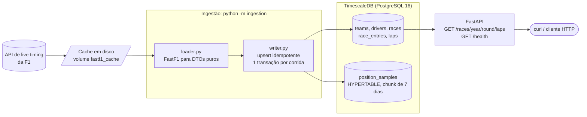
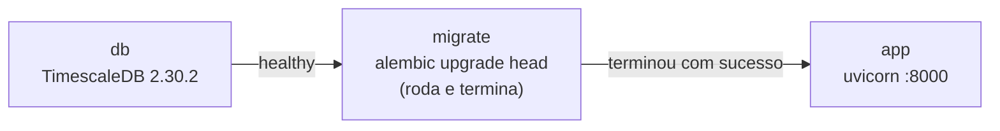
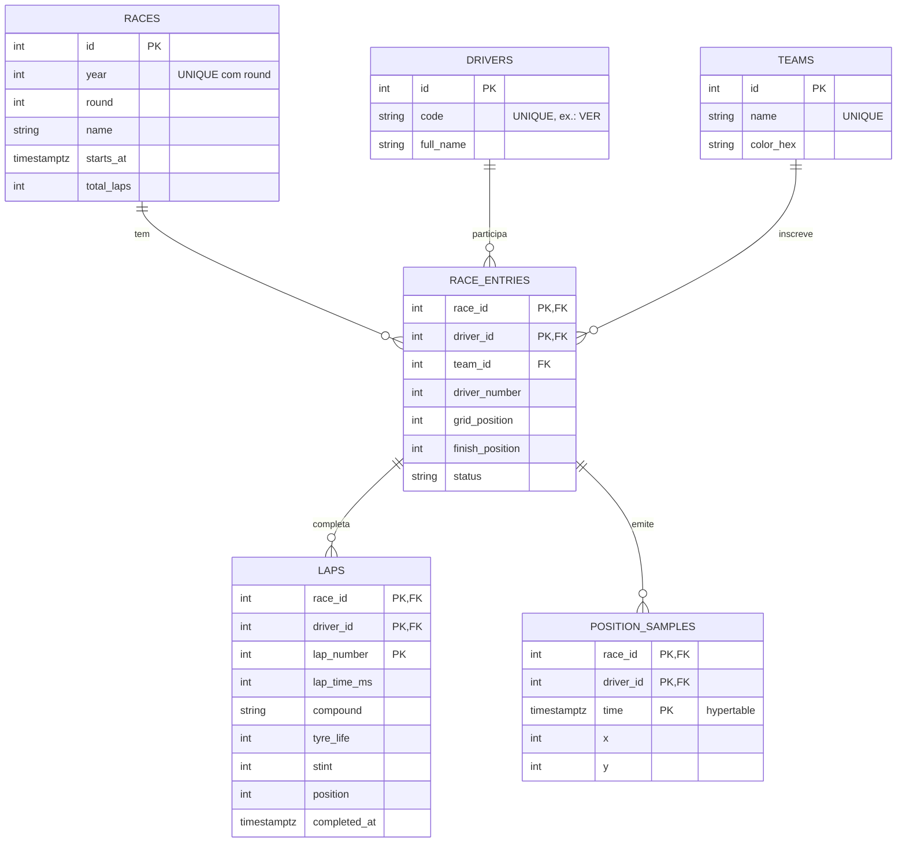

# F1 Race Engineer

Pipeline de dados de Fórmula 1: baixa uma corrida pelo [FastF1](https://github.com/theOehrly/Fast-F1),
grava pilotos, equipes, voltas e a **telemetria de posição (x, y)** num TimescaleDB e serve tudo
por uma API REST.

Com o GP do Brasil 2024 de exemplo: **797.642 amostras de posição** (~75 MB com índices),
1.134 voltas e 20 pilotos entram no banco em cerca de 1 minuto, e rodar a ingestão de novo
**não altera nenhuma linha**.

> Projeto independente de portfólio. Sem vínculo com a Formula 1; usa dados públicos via FastF1.

**Stack:** Python 3.12 · FastAPI · SQLAlchemy 2.0 + Alembic · PostgreSQL 16 + TimescaleDB ·
FastF1 · pytest · Docker Compose · GitHub Actions

## Arquitetura



O `loader` é a única parte que conhece o FastF1 e devolve dataclasses com tipos nativos do Python.
O `writer` só conhece essas dataclasses e o banco. Essa fronteira é o que deixa o `writer`
testável sem rede e permite trocar a fonte de dados sem tocar na gravação.

### O que sobe com `docker compose up`



A migration é um **job separado** (e não parte do startup do app) para que, com várias réplicas,
ela rode exatamente uma vez por `up` em vez de várias disputando o mesmo schema.

### Modelo de dados



## Como rodar

### Com Docker (recomendado)

```bash
cp .env.example .env              # opcional: tudo tem default de desenvolvimento
docker compose up --build -d      # sobe banco, aplica as migrations e sobe a API

# Ingere o GP do Brasil 2024 (2024, etapa 21). A 1ª vez baixa os dados (~1 min ou mais);
# as seguintes reaproveitam o cache.
docker compose run --rm app python -m ingestion --year 2024 --round 21

curl -s localhost:8000/health
curl -s "localhost:8000/races/2024/21/laps?driver=VER" | head -c 600
```

Documentação interativa (Swagger) em <http://localhost:8000/docs>.

Se a porta 5432 ou a 8000 já estiverem ocupadas na sua máquina, defina `POSTGRES_PORT` e/ou
`APP_PORT` no `.env` (por exemplo `POSTGRES_PORT=55432`). Elas só mudam a porta **publicada no
host**; dentro da rede do Compose o app sempre fala com `db:5432`.

Para parar: `docker compose down` mantém os dados; `docker compose down -v` apaga os volumes.

### Sem Docker para a API (desenvolvimento)

Só o banco roda no Docker; Python roda na sua máquina.

```bash
python -m venv .venv && source .venv/bin/activate
pip install -r requirements-dev.txt

cp .env.example .env              # ajuste POSTGRES_PORT / REDIS_PORT se tiver mapeado outras portas
docker compose up -d db redis

alembic upgrade head
python -m ingestion --year 2024 --round 21
uvicorn app.main:app --reload
```

## API

| Endpoint | Descrição | Respostas |
|---|---|---|
| `GET /health` | Separa **processo vivo**, **banco** e **Redis** | `200` (com `status: "degraded"` se só o Redis caiu) · `503` banco inacessível |
| `GET /races/{year}/{round}/laps` | Voltas da corrida (tempo, composto, idade do pneu, stint, posição) | `200` · `404` corrida não ingerida · `422` parâmetro inválido |
| `GET /races/{year}/{round}/laps?driver=VER` | Só as voltas de um piloto (código de 3 letras, sem diferenciar maiúsculas) | `200` · `404` piloto fora da corrida · `422` formato inválido |

Regras que valem a pena conhecer:

- **404 que orienta:** corrida inexistente indica o comando de ingestão; piloto fora da corrida
  lista os códigos válidos daquela corrida.
- **Piloto que não largou** (DNS) é `200` com lista vazia: ele consta na corrida, só não tem voltas.
  Isso é diferente de um código que não participou (`404`).
- **`/health` com banco fora do ar** responde `503` com o corpo
  `{"status":"degraded","checks":{"process":"ok","database":"unavailable","redis":"ok"}}`. O detalhe
  do erro vai só para o log, nunca para a resposta.
- **`/health` com só o Redis fora** continua `200`: o corpo traz `"redis":"unavailable"` e
  `"status":"degraded"`, mas o código HTTP não muda. Só o streaming depende do Redis; as rotas REST
  seguem funcionando, e tirar a instância do balanceador derrubaria o que ainda funciona. O PING
  tem limite de 1 s para o healthcheck do Docker (3 s) nunca estourar por causa do Redis.

Exemplo (`?driver=VER`, GP do Brasil 2024, trecho):

```json
{
  "race": { "year": 2024, "round": 21, "name": "São Paulo Grand Prix", "total_laps": 69 },
  "driver": "VER",
  "laps": [
    { "driver": "VER", "lap_number": 1, "lap_time_ms": 99161, "compound": "INTERMEDIATE",
      "tyre_life": 1, "stint": 1, "position": 11, "completed_at": "2024-11-03T15:51:36.953000Z" },
    { "driver": "VER", "lap_number": 2, "lap_time_ms": 87134, "compound": "INTERMEDIATE",
      "tyre_life": 2, "stint": 1, "position": 10, "completed_at": "2024-11-03T15:53:04.087000Z" }
  ]
}
```

## Testes

```bash
pytest -m "not integration"       # unitários: poucos segundos, sem banco nem rede
pytest                            # tudo; requer banco e Redis (docker compose up -d db redis)
```

- **Unitários:** SQLite em memória com dados semeados à mão, e DataFrames sintéticos com as
  mesmas colunas e tipos do FastF1 (incluindo os casos de borda: volta sem tempo, piloto sem
  composto de pneu, nulos nas posições). Nenhum teste baixa dados da F1.
- **Integração** (marker `integration`; Redis real no banco lógico 15, esvaziado a cada teste):
  cada execução cria um **banco descartável** no
  TimescaleDB do Compose, roda a migration de verdade e o apaga no final, então seus dados de
  desenvolvimento nunca são tocados. Cobrem o que o SQLite não alcança: a hypertable, o
  `ON CONFLICT` do Postgres, a atomicidade da ingestão e a deriva entre models e migrations
  (`alembic check`).
- Sem banco acessível, os de integração são **pulados** com a instrução de como subir o banco.
  Com `REQUIRE_INTEGRATION_DB=1` (o que o CI usa) eles **falham**, para nunca passarem em silêncio.

Lint: `ruff check . && ruff format --check .`

O CI (GitHub Actions) roda o lint primeiro, para falhar rápido, e só então os testes, com
TimescaleDB e Redis reais como service containers.

## Decisões de design

| Decisão | Por quê |
|---|---|
| **TimescaleDB** (hypertable em `position_samples`) | Telemetria é uma série temporal grande (~800 mil linhas por corrida). A tabela é particionada por tempo em chunks de 7 dias (o calendário da F1 tem ~1 corrida por semana, então cada corrida cai num chunk): escrita em lote toca só índices pequenos, consultas por janela abrem só os chunks relevantes, e apagar telemetria antiga vira operação por chunk. |
| **Só 2 índices na tabela grande** | A PK `(race_id, driver_id, time)` serve "trajetória de um piloto numa janela"; `(race_id, time)` serve "corrida inteira em ordem de tempo". O índice automático só em `time` foi desligado: nenhuma consulta filtra por tempo sem filtrar a corrida, e cada índice a mais encarece a escrita. Num teste local com 600 mil linhas sintéticas, ler a corrida em ordem de tempo levou ~0,1 ms com o índice e ~22 ms sem ele (indicativo: foi num PostgreSQL puro, sem Timescale). |
| **Ingestão idempotente** | Três camadas: (1) o schema tem chaves naturais únicas, então o banco garante a unicidade; (2) todo `INSERT` é `ON CONFLICT`, nunca "checa e depois insere" (que tem corrida entre o SELECT e o INSERT); (3) 1 transação por corrida, então uma falha no meio não deixa corrida pela metade. Voltas e inscrições só são reescritas se algo mudou; posições (fatos imutáveis) usam `DO NOTHING`. Rodar duas vezes reporta 0 linhas alteradas. |
| **Loader separado do writer** | Só o loader conhece o FastF1 e o formato dele. O download acontece **antes** de abrir a transação, para não segurar conexão de banco durante minutos de rede. |
| **Equipe em `race_entries`, não em `drivers`** | O piloto troca de equipe entre temporadas; guardar a equipe no piloto reescreveria o passado a cada ingestão. A FK composta `(race_id, driver_id)` também impede volta ou posição de quem não correu aquela corrida. |
| **Migration como job separado** | Ver o diagrama de subida acima. |
| **Imagem do Timescale com versão fixa** | A extensão vive dentro do volume de dados; trocar a versão do binário sob um volume existente exige `ALTER EXTENSION ... UPDATE`. Fixar evita que um `pull` mude o comportamento sem ninguém perceber. |
| **`/health` com `connect_timeout`** | Sem timeout, um banco sumido na rede (firewall descartando pacotes) faria o endpoint pendurar em vez de responder `503`. |
| **Contrato da API separado dos models** | `schemas.py` ≠ `models.py`: o banco pode evoluir sem quebrar quem consome a API. |

### O que os dados reais ensinaram

Inspecionar o GP do Brasil 2024 antes de escrever o mapeamento evitou vários erros:

- **Os horários do FastF1 vêm sem fuso, mas são UTC.** A largada real (15:49) bate com o horário
  oficial agendado (15:30 UTC) mais o atraso da corrida. Tratados como `timestamptz` em UTC.
- **O fim de uma volta é `t0_date + Time`, não `LapStartDate`.** Com bandeira vermelha, a volta
  seguinte só "começa" até ~23 minutos depois do fim da anterior.
- **14% das amostras de posição são `(0, 0)`:** placeholder de "sem sinal de GPS", inclusive no
  meio da corrida. Descartar todas evita carros teletransportados para a origem do mapa.
- **Inteiros vêm como `float`** (para aceitar NaN), e voltas sem tempo (largada, box) vêm como
  `NaT`. Tudo é normalizado para `int | None`.
- O contador de linhas do SQLAlchemy devolve `-1` em `INSERT`; o relatório de idempotência usa
  `preserve_rowcount` para mostrar números reais.

## Estrutura

```
app/            API FastAPI (config, deps, schemas, routers/)
ingestion/      loader (FastF1), writer (upsert), pipeline e CLI
db/             models SQLAlchemy, sessão e migrations Alembic
replay/         motor de replay: fonte (keyset), timeline, engine, publisher, lock, manager
tests/          unitários, ingestion/ (loader, CLI) e integration/ (Timescale real)
.github/        workflow de CI
docker-compose.yml · Dockerfile · .env.example
```

## Roadmap

- **Fase 2 (planejada):** replay da corrida em tempo real a partir do banco, com Redis Streams
  e WebSocket.
