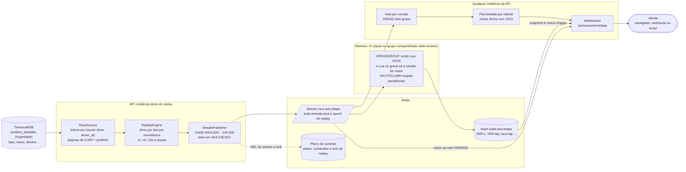
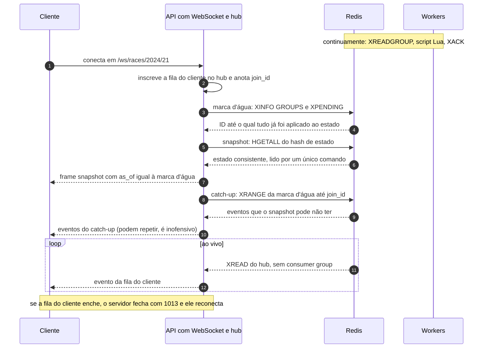
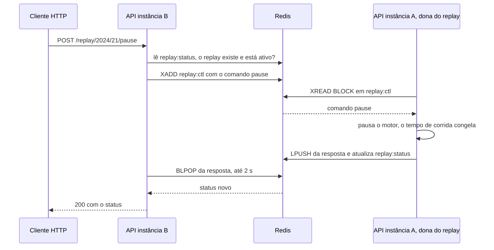
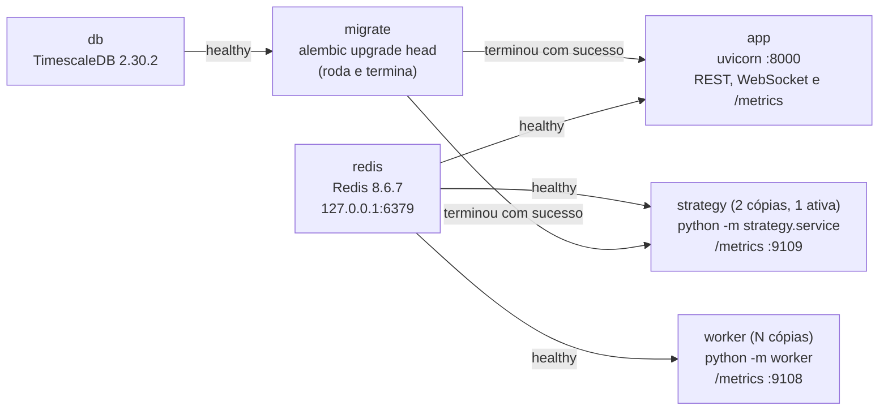
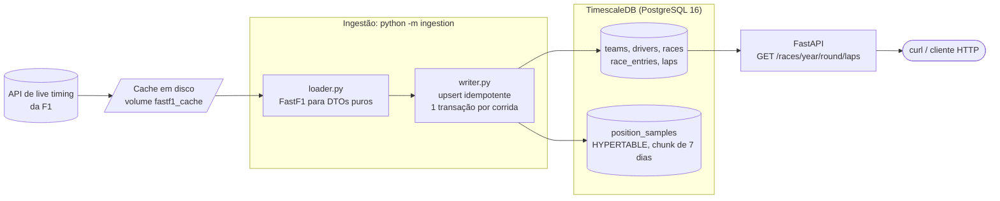
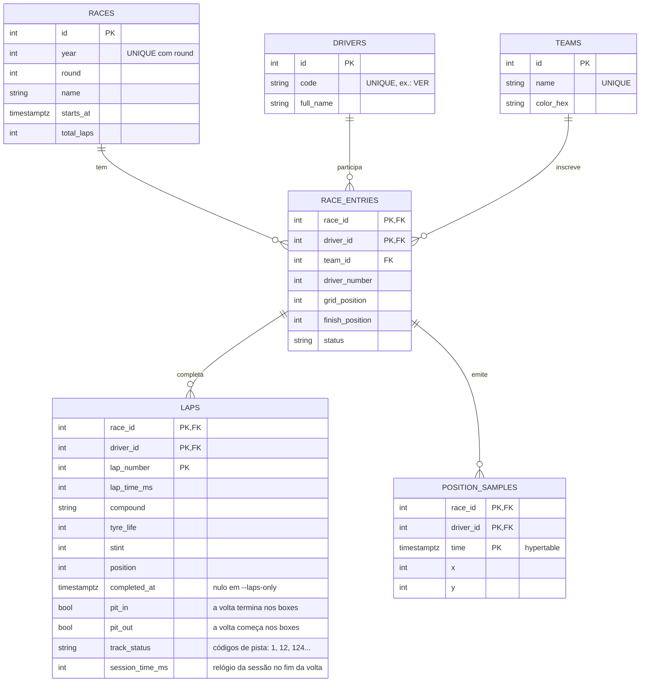

# F1 Race Engineer

[](https://github.com/isabelaohanadev/f1-race-engineer/actions/workflows/ci.yml)

Pipeline de dados de Fórmula 1 com **replay de corrida em tempo real**. Baixa uma corrida pelo
[FastF1](https://github.com/theOehrly/Fast-F1), grava pilotos, equipes, voltas e a **telemetria de
posição (x, y)** num TimescaleDB, serve tudo por uma API REST e **reproduz a corrida gravada como se
fosse ao vivo**: um motor de replay publica eventos em Redis Streams, workers mantêm o estado atual
da corrida e clientes WebSocket recebem um snapshot e, em seguida, os eventos em tempo real.

Com o GP do Brasil 2024 de exemplo: **797.642 amostras de posição** (~75 MB com índices), 1.134
voltas e 20 pilotos entram no banco em cerca de 1 minuto (e reingerir **não altera nenhuma linha**).
O replay lê essas 797 mil linhas com **~4 MB de memória** (em vez de ~270 MB) e entrega eventos ao
cliente com latência de poucos milissegundos.

> Projeto independente de portfólio. Sem vínculo com a Formula 1; usa dados públicos via FastF1.

**Stack:** Python 3.12 · FastAPI (REST + WebSocket) · SQLAlchemy 2.0 + Alembic · PostgreSQL 16 +
TimescaleDB · Redis 8 (Streams, consumer groups, Lua) · Prometheus · FastF1 · pytest · Docker
Compose · GitHub Actions

## Arquitetura

### O fluxo completo



Duas ideias sustentam o desenho. **O estado mora no Redis**, não na memória de um worker: assim
vários workers dividem a carga e qualquer instância da API consegue montar um snapshot.
**A consistência vem do dado, não da ordem**: cada atualização carrega uma versão (o tempo de
corrida) e um *epoch* (o número do replay), então o resultado final é o mesmo qualquer que seja a
ordem em que os workers processem os eventos, e reprocessar um evento é inofensivo.

### Como um cliente entra no meio do replay, sem buracos



O ponto sutil é o passo 3. A receita "anotar o último ID do stream, ler o snapshot e seguir o
stream dali" tem um **buraco**: o worker aplica o evento *depois* de ele ser publicado, então os
eventos já publicados e ainda não aplicados não estão no snapshot, e o `XREAD` só traz o que vem
depois do ID anotado. Por isso o ponto de partida é a **marca d'água**: o ID até o qual tudo já foi
*aplicado* (o menor pendente do grupo menos 1, ou o último entregue). O que está entre a marca
d'água e `join_id` vem do próprio stream (catch-up), e o que vem depois de `join_id` vem da fila do
cliente. Eventos podem chegar repetidos; como a atualização é idempotente, isso não faz mal.

### Controle do replay entre processos

O motor roda na instância da API que recebeu o `start`, mas qualquer instância controla o replay:



O status é um hash com TTL de 10 s que o dono renova a cada ~1 s: se o dono morre, o status expira
sozinho e o replay deixa de aparecer como ativo. Um lock no Redis garante **um replay por corrida**
mesmo com várias instâncias (o segundo `start` recebe `409`).

### O que sobe com `docker compose up`



A migration é um **job separado** (e não parte do startup do app) para que, com várias réplicas,
ela rode exatamente uma vez por `up` em vez de várias disputando o mesmo schema. O worker recebe só
as variáveis do Redis: não tem a senha do Postgres. O consumidor de estratégia (Fase 3) precisa do
Postgres também (as constantes do modelo saem do banco) e sobe com **duas cópias, das quais só uma
calcula** (lock + standby, ver `docs/estrategia-ao-vivo.md`).

### Ingestão (Fase 1)



O `loader` é a única parte que conhece o FastF1 e devolve dataclasses com tipos nativos do Python.
O `writer` só conhece essas dataclasses e o banco. Essa fronteira é o que deixa o `writer`
testável sem rede e permite trocar a fonte de dados sem tocar na gravação.

### Modelo de dados



## Como rodar do zero

Precisa de **Docker** (Compose v2) e, para o script de exemplo e os testes, **Python 3.12+**.

### 1. Configuração (`.env`)

```bash
cp .env.example .env
```

**Se você já tem um PostgreSQL rodando na máquina** (comum no macOS e no Windows), a porta 5432 está
ocupada e o `docker compose up` falha com `ports are not available ... 5432 ... address already in
use`. Mude a porta **publicada no host** antes da primeira subida:

```bash
sed -i.bak 's/^POSTGRES_PORT=.*/POSTGRES_PORT=55432/' .env      # ou edite o .env à mão
```

Isso só muda a porta que o *seu computador* enxerga (para `psql`, DBeaver, os testes e a ingestão
fora do Docker). Dentro da rede do Compose o app continua falando com `db:5432`. Trocar a porta
depois de o banco já ter subido recria o container `db`, mas os dados ficam: vivem no volume
`pgdata`. O mesmo vale para `REDIS_PORT` (6379) e `APP_PORT` (8000).

### 2. Subir tudo

```bash
docker compose up --build -d --scale worker=2    # banco, migrations, API, Redis e 2 workers
curl -s localhost:8000/health
# {"status":"ok","checks":{"process":"ok","database":"ok","redis":"ok"}}
```

Documentação interativa (Swagger) em <http://localhost:8000/docs>.

### 3. Ingerir uma corrida

```bash
# GP do Brasil 2024 (2024, etapa 21). A 1ª vez baixa os dados (~1 min ou mais); as seguintes
# reaproveitam o cache.
docker compose run --rm app python -m ingestion --year 2024 --round 21
curl -s "localhost:8000/races/2024/21/laps?driver=VER" | head -c 600

# Só voltas e resultado, sem a telemetria de posição: ~10 s em vez de minutos e sem as ~800 mil
# linhas de posição. A corrida fica sem trajetória (sem replay de posições) e sem o horário absoluto
# das voltas (`completed_at`), que o FastF1 só calcula com a telemetria; as colunas e os horários que
# já estiverem no banco não são tocados. Serve à análise de estratégia, que só usa voltas.
docker compose run --rm app python -m ingestion --year 2024 --round 6 --laps-only
```

Para ver o que entrou, e se dá para confiar nisso, rode o inspetor de qualidade das voltas (relatório
em `docs/qualidade-dos-dados.md`, com a legenda de cada coluna):

```bash
python -m strategy.quality                                         # tabelas no terminal
python -m strategy.quality --markdown docs/qualidade-dos-dados.md  # e grava o relatório
```

E o funil da limpeza, que mostra quantas voltas cada regra tira por corrida (só ficam as voltas com
status exatamente `1`; a amarela aparece separada e corridas que perdem mais de 40% são sinalizadas),
em `docs/limpeza-das-voltas.md`:

```bash
python -m strategy.cleaning --markdown docs/limpeza-das-voltas.md
```

E o coeficiente de combustível (físico x estimado) e a sensibilidade da degradação a ele, em
`docs/combustivel.md`:

```bash
python -m strategy.fuel --markdown docs/combustivel.md
```

E a "verdade" do backtest (a ordem na pista) contra o resultado oficial, corrida a corrida, em
`docs/verdade-do-backtest.md`:

```bash
python -m strategy.results --markdown docs/verdade-do-backtest.md
```

E quais corridas entram no backtest principal e quais ficam à parte:

```bash
python -m strategy.population
```

E o modelo de degradação, com a calibração e as corridas à parte, em `docs/degradacao.md`:

```bash
python -m strategy.degradation --markdown docs/degradacao.md
```

E a perda no pit e as constantes por corrida, com a reserva calculada sem cada corrida, em
`docs/perda-no-pit.md`:

```bash
python -m strategy.race_stats --markdown docs/perda-no-pit.md
```

### 4. Iniciar o replay e assistir

```bash
# 16x: o GP gravado tem ~3 h de dados (a largada foi bem depois do início), então a 16x leva ~12 min
curl -X POST localhost:8000/replay/2024/21/start -H 'content-type: application/json' -d '{"speed": 16}'
```

Três formas de ver o stream (as duas primeiras imprimem o snapshot e depois os eventos):

```bash
# a) com websocat (https://github.com/vi/websocat)
websocat ws://localhost:8000/ws/races/2024/21 | head -n 20

# b) com o script Python (precisa de `pip install websockets`, que já vem com uvicorn[standard])
python scripts/watch_race.py --year 2024 --round 21            # resumo a cada segundo
python scripts/watch_race.py --year 2024 --round 21 --events   # cada evento (muito volume)
```

```text
c) no navegador: http://localhost:8000/frontend/
```

A página (`frontend/`, HTML e JS puros, sem build, servida pela própria API) conecta sozinha, mostra
o snapshot, os contadores, a classificação ao vivo e o log de eventos, e tem botões para iniciar,
pausar, retomar, mudar a velocidade e parar o replay. Os eventos de posição (~99% do volume) só vão
para o log se você marcar a opção, senão a tela seria ilegível a 16x.

O `scripts/watch_race.py` é também um **cliente de referência**: a classe `RaceView` implementa, em
~40 linhas, as regras do protocolo (ver abaixo) e é a mesma que os testes validam.

### 5. Controlar o replay (de qualquer instância da API)

```bash
curl -X POST localhost:8000/replay/2024/21/pause
curl -X POST localhost:8000/replay/2024/21/speed -H 'content-type: application/json' -d '{"speed": 4}'
curl -X POST localhost:8000/replay/2024/21/resume
curl      localhost:8000/replay/2024/21                  # status: estado, velocidade, volta, dono
curl -X POST localhost:8000/replay/2024/21/stop
```

### 6. Estratégia ao vivo (Fase 3)

Com o replay rodando (passo 4, numa das corridas com replay: 2024 etapas 6, 10, 13 ou 16; o Brasil
é chuva, fora do domínio do modelo), o serviço `strategy` calcula a cada volta do líder, a partir da
volta 5:

```bash
curl -s "localhost:8000/races/2024/10/strategy" | python -m json.tool   # a volta mais recente
curl -s "localhost:8000/races/2024/10/strategy?lap=20"                  # uma volta
python scripts/watch_race.py --year 2024 --round 10                     # o Monte Carlo ao lado do líder atual
```

A página (`/frontend/`) tem o painel "Estratégia". **Leia "O backtest" antes de confiar no número:
o Monte Carlo não superou "o líder atual vence".** Detalhes e limitações em
`docs/estrategia-ao-vivo.md`.

### 7. Métricas

```bash
curl -s localhost:8000/metrics | grep -E "^f1_"                  # API
curl -s "http://$(docker compose port --index 1 worker 9108)/metrics" | grep -E "^f1_worker"   # worker 1
```

Para parar: `docker compose down` mantém os dados; `docker compose down -v` apaga os volumes.

### Sem Docker para a API (desenvolvimento)

Só o banco e o Redis rodam no Docker; a API e o worker rodam na sua máquina (dois terminais).

```bash
python -m venv .venv && source .venv/bin/activate
pip install -r requirements-dev.txt

cp .env.example .env              # ajuste POSTGRES_PORT / REDIS_PORT se precisar
docker compose up -d db redis

alembic upgrade head
python -m ingestion --year 2024 --round 21
uvicorn app.main:app --reload     # terminal 1: a API
python -m worker                  # terminal 2: o worker (inicie mais cópias se quiser)
```

## API

| Endpoint | Descrição | Respostas |
|---|---|---|
| `GET /health` | **Processo vivo**, **banco** e **Redis** | `200` (com `status: "degraded"` se só o Redis caiu) · `503` banco inacessível |
| `GET /metrics` | Métricas Prometheus da API | `200` |
| `GET /races/{year}/{round}/laps` | Voltas da corrida (tempo, composto, idade do pneu, stint, posição) | `200` · `404` corrida não ingerida · `422` parâmetro inválido |
| `GET /races/{year}/{round}/laps?driver=VER` | Só as voltas de um piloto (código de 3 letras) | `200` · `404` piloto fora da corrida · `422` formato inválido |
| `POST /replay/{year}/{round}/start` | Inicia o replay nesta instância (corpo opcional: `{"speed": 1\|4\|16}`) | `202` · `404` corrida não ingerida · `409` já há replay · `422` velocidade inválida ou corrida sem dados · `503` Redis fora |
| `POST /replay/{year}/{round}/pause` `/resume` `/stop` | Pausa (congela o tempo de corrida), retoma de onde parou, encerra | `200` com o status · `409` não há replay ativo · `504` o dono não respondeu |
| `POST /replay/{year}/{round}/speed` | Muda para 1x, 4x ou 16x sem reiniciar nem pular | `200` · `409` · `422` · `504` |
| `GET /replay/{year}/{round}` | Status do replay, lido do Redis (vale de qualquer instância) | `200` · `404` nunca iniciado ou expirado |
| `GET /races/{year}/{round}/strategy?lap=N` | Estratégia de uma volta do líder (sem `lap`: a mais recente): Monte Carlo **ao lado de "o líder atual vence"**, voltas que faltam, `reliability`, alertas de undercut e avisos de pista. **Só lê** o que o consumidor de estratégia gravou | `200` · `404` ainda sem resultado (a mensagem diz de onde ele vem) · `422` `lap` inválida · `500` formato que a API não entende |
| `WS /ws/races/{year}/{round}` | Snapshot do estado e, depois, os eventos em tempo real (inclusive o `strategy`) | fecha com `1013` se o cliente for lento |
| `GET /frontend/` | Página de teste do WebSocket (HTML + JS, servida pela API) | `200` |

Regras que valem a pena conhecer:

- **404 que orienta:** corrida inexistente indica o comando de ingestão; piloto fora da corrida
  lista os códigos válidos daquela corrida.
- **Piloto que não largou** (DNS) é `200` com lista vazia: ele consta na corrida, só não tem voltas.
  Isso é diferente de um código que não participou (`404`).
- **`/health` com o banco fora** responde `503`. **Com só o Redis fora** continua `200`: o corpo traz
  `"redis":"unavailable"` e `"status":"degraded"`, mas o código HTTP não muda, porque só o streaming
  depende do Redis e as rotas REST seguem funcionando (tirar a instância do balanceador derrubaria
  o que ainda funciona). O detalhe de qualquer erro vai só para o log, nunca para a resposta.
- **Um replay por corrida**, mesmo com várias instâncias: o segundo `start` recebe `409`.

### O protocolo do WebSocket

O 1º frame é sempre o snapshot (JSON de texto); depois chega **um evento por frame**. Os exemplos
abaixo estão abreviados (o snapshot real traz todos os carros e todos os campos do status).

```json
{"type": "snapshot", "as_of": "1730649000123-0", "epoch": 3,
 "race": {"state": "running", "lap": 3, "total_laps": 69},
 "cars": {"VER": {"x": -3949, "y": -4124, "pos_t": 1730649000100,
                  "lap": 2, "lap_t": 1730648990000, "lap_time_ms": 87134,
                  "compound": "SOFT", "position": 1}},
 "classification": ["VER", "NOR", "LEC"],
 "replay": {"state": "running", "speed": 16.0, "owner": "api-1", "epoch": 3}}

{"type": "position",      "id": "1730649000125-0", "epoch": 3, "driver": "VER", "x": -3950, "y": -4120, "t": 1730649000320}
{"type": "lap_completed", "id": "1730649000130-0", "epoch": 3, "driver": "NOR", "lap": 3, "t": 1730649001000,
 "lap_time_ms": 87500, "compound": "SOFT", "position": 2}
{"type": "race_status",   "id": "1730649000131-0", "epoch": 3, "state": "running", "lap": 4, "total_laps": 69, "t": 1730649001000}
```

```json
{"type": "strategy", "v": 1, "id": "1730649000140-0", "epoch": 3, "lap": 30, "total_laps": 66,
 "laps_left": 36, "reliability": "indicative",
 "baseline": {"name": "o líder atual vence", "leader": "VER"},
 "forecast": {"drivers": [{"driver": "VER", "win": 0.62, "baseline_win": 1.0, "podium": 0.97}]},
 "alerts": [], "warnings": [], "inputs": {"cars_reported": 20, "cars_known": 20}}
```

`t` é o instante da corrida em milissegundos Unix (UTC); `id` é o ID da entrada no stream. O evento
`strategy` (abreviado acima; o formato completo está em `docs/estrategia-ao-vivo.md`) chega uma vez
por volta calculada do líder, e quem **entra no meio** recebe o último logo depois do snapshot.
**Mostre sempre `baseline_win` ao lado de `win`**: no backtest o Monte Carlo não superou "o líder
atual vence" (ver "O backtest"). Quem escreve um cliente precisa seguir **cinco regras** (todas
implementadas em `RaceView`, em `scripts/watch_race.py`, e na página):

1. **Epoch.** Um evento com `epoch` **maior** que o seu é de um replay novo: descarte o estado e
   recomece. Um com epoch **menor** é de um replay antigo: ignore.
2. **Versões por piloto.** Uma `position` só vale se o `t` dela for **maior** que o `pos_t` que você
   já tem; uma `lap_completed`, se o `t` for maior que o `lap_t`. Eventos repetidos (o catch-up
   repete o que o snapshot já refletia) ficam inofensivos.
3. **Status da corrida.** Só avança em (volta, estado): `started` < `running` < `finished`.
4. **Classificação** (derivada): mais voltas completas primeiro; empatando, quem cruzou a linha
   antes. É a ordem **na pista** (ver as limitações).
5. **Estratégia.** Vale o `strategy` de **maior `lap`** do epoch atual (o repetido ou atrasado não
   volta atrás) e só se `v` é uma versão que o cliente conhece; uma versão nova deve ser **dita**, não
   adivinhada.

Códigos de fechamento: `1013` (tente de novo: o cliente não acompanhou a velocidade dos eventos; ao
reconectar ele recebe um snapshot novo) e `1011` (Redis indisponível).

## Métricas

Cada processo expõe as **suas** métricas: a API em `/metrics`, o worker em `:9108/metrics` (porta
configurável por `WORKER_METRICS_PORT`, `0` desliga) e o consumidor de estratégia em `:9109/metrics`
(`STRATEGY_METRICS_PORT`). No Compose a porta do worker e a do consumidor são publicadas em
`127.0.0.1` com número sorteado (funciona com várias cópias): descubra com
`docker compose port --index 1 worker 9108`.

| Métrica | Tipo | Onde | O que mede |
|---|---|---|---|
| `f1_ws_clients_connected` | gauge | API | Clientes WebSocket conectados a esta instância |
| `f1_ws_connections_total` | counter | API | Conexões aceitas |
| `f1_ws_slow_client_disconnects_total` | counter | API | Clientes desconectados (1013) por lentidão |
| `f1_replay_events_published_total` | counter | API | Eventos publicados pelo motor (use `rate()` para eventos/s) |
| `f1_delivery_latency_seconds` | histograma | API | Publicação no stream até o fim do envio ao cliente, buckets de 1 ms a 1 s |
| `f1_stream_length{race}` | gauge | API | Entradas retidas no stream da corrida |
| `f1_consumer_group_lag{race,group}` | gauge | API | Entradas que o grupo ainda **não leu** |
| `f1_consumer_group_pending{race,group}` | gauge | API | Entregues e sem `XACK` (em processamento, ou de um worker morto) |
| `f1_redis_up` | gauge | API | `1` se o scrape leu o Redis, `0` se não |
| `f1_worker_events_total{result}` | counter | worker | `applied`, `ignored` (a trava de ordem em ação) e `malformed` |
| `f1_worker_claimed_total` | counter | worker | Entradas resgatadas de um worker que sumiu (`XAUTOCLAIM`) |
| `f1_worker_apply_latency_seconds` | histograma | worker | Publicação até o estado gravado: o quão fresco está o snapshot |
| `f1_strategy_consumer_active` | gauge | estratégia | `1` na instância que segura o lock, `0` em standby (a soma entre as cópias deve ser 1) |
| `f1_strategy_last_result_age_seconds` | gauge | estratégia | Idade do último resultado **gravado** (NaN antes do primeiro): sobe com o replay pausado ou a simulação travada |
| `f1_strategy_simulation_duration_seconds{result}` | histograma | estratégia | Duração da simulação (`completed`, `cancelled`, `stale`, `failed`) |
| `f1_strategy_laps_total{outcome}` | counter | estratégia | Voltas lidas: `applied`, `duplicate`, `late`, `stale_epoch`, `status`, `ignored`, `malformed` |
| `f1_strategy_results_total{outcome}` | counter | estratégia | Entregas: `written`, `exists`, `fenced`, `skipped`, `dropped` |

Detalhes que importam:

- **Lag e tamanho do stream são lidos no instante do scrape** por um *collector* customizado
  (`XINFO GROUPS`), e não por um laço de fundo que atualiza um gauge a cada N segundos: o valor é,
  por construção, o de agora, não gasta Redis sem ninguém raspando e não vira mais uma tarefa para
  dar errado.
- **O lag sai da API, não do worker**: é a métrica que alerta "os workers não dão conta". Se
  dependesse do worker, quando *todos* morressem (o pior caso) ela sumiria junto.
- **Cardinalidade:** os únicos rótulos são `race`, `group`, `result` e `outcome` (poucos valores
  fixos). Piloto, ID de evento, nome de consumidor ou cliente **nunca** viram rótulo (seriam milhares
  de séries). Há um teste que varre os registros e falha se isso mudar.
- **Se o Redis cair**, o `/metrics` não falha: `f1_redis_up` vai a `0` e o resto continua exposto.
- `/metrics` não tem autenticação (não há dado sensível); em produção restrinja o acesso na borda.

Exemplo de configuração do Prometheus e de consultas:

```yaml
scrape_configs:
  - job_name: f1-api
    static_configs: [{targets: ["app:8000"]}]
  - job_name: f1-worker
    dns_sd_configs: [{names: ["worker"], type: A, port: 9108}]   # uma instância por cópia
  - job_name: f1-strategy
    dns_sd_configs: [{names: ["strategy"], type: A, port: 9109}]  # a ativa e a standby
```

```promql
sum(rate(f1_replay_events_published_total[1m]))                                   # eventos/s
max by (race) (f1_consumer_group_lag)                                             # alerta se subir e não descer
histogram_quantile(0.99, sum by (le) (rate(f1_delivery_latency_seconds_bucket[1m])))   # p99 de entrega
sum(f1_strategy_consumer_active)                                                  # deve ser exatamente 1
max(f1_strategy_last_result_age_seconds)                                          # alerta se passar de ~2 voltas com replay rodando
```

### Por que não o modo multiprocess do `prometheus-client`

O modo multiprocess (`PROMETHEUS_MULTIPROC_DIR`) existe para servidores que **bifurcam** em vários
processos que respondem pelo mesmo endpoint (por exemplo, `gunicorn -w 4`): cada processo grava suas
métricas em arquivos mapeados em memória num diretório compartilhado, e a raspagem os agrega. Não é
o nosso caso, e custaria caro:

- API e worker são **programas diferentes**, com ciclos de vida diferentes. Cada um é um alvo de
  scrape próprio, e o Prometheus já foi feito para isso (rótulo `instance`, agregação com `sum by`).
  Juntá-los exigiria um volume compartilhado entre os containers, acoplando dois serviços só por
  causa das métricas.
- Esconde a saúde por processo: as métricas de um worker morto ficariam no diretório até alguém
  limpar, em vez de o alvo simplesmente sumir (que é o sinal certo).
- Os *collectors* que leem estado no instante do scrape (clientes conectados, lag do Redis) não
  combinam com o modo multiprocess, que agrega arquivos de contadores.

Se um dia a API rodar com vários processos `uvicorn --workers N` *dentro do mesmo container*, aí
sim o modo multiprocess passa a fazer sentido, só para a API.

## Testes

```bash
pytest -m "not integration"       # unitários: segundos, sem banco, Redis nem rede
pytest                            # tudo; requer banco e Redis (docker compose up -d db redis)
```

- **Unitários:** SQLite em memória com dados semeados à mão e DataFrames sintéticos com as mesmas
  colunas e tipos do FastF1; o motor de replay usa um **relógio injetado** (nada de `sleep` real, o
  teste roda uma hora de corrida em milissegundos e confere o instante exato de cada evento). O
  `tests/test_frontend.py` roda o JS da página no `node` e o compara com o cliente Python em 60
  cenários aleatórios, executa o script da página com um DOM de mentira e confere o painel de
  estratégia (é pulado se o `node` não existir).
- **Integração** (marker `integration`): **TimescaleDB e Redis reais**. Cada execução cria um banco
  descartável (a migration roda de verdade) e usa o banco lógico 15 do Redis, esvaziado a cada
  teste, então seus dados de desenvolvimento nunca são tocados. Cobrem o que um dublê não alcança:
  a hypertable, o `ON CONFLICT`, o script Lua, o consumer group, o `XAUTOCLAIM`, o controle entre
  processos e um servidor `uvicorn` **real** com clientes WebSocket reais entrando no meio de um
  replay. O consumidor de estratégia tem os dele contra o Redis real: a queda com um `SIGKILL` de
  verdade, o lock e o standby, o epoch, a duplicata, o embaralhamento e a cadeia inteira (banco,
  replay, consumidor, hub, WebSocket e `GET`).
- Sem banco/Redis acessível, os de integração são **pulados** com a instrução de como subir; com
  `REQUIRE_INTEGRATION_DB=1` (o que o CI usa) eles **falham**, para nunca passarem em silêncio.
- **Por que Redis real, e não `fakeredis` ou `testcontainers`:** o que precisa de prova (Lua,
  `XAUTOCLAIM`, `BLPOP`, o bloqueio do `XREAD`, a expiração por TTL) são comportamentos *do
  servidor*, e um emulador só cobre parte deles, com risco de falso positivo. `testcontainers`
  resolveria, mas subiria containers de dentro dos testes; o Redis do Compose (e o *service
  container* do CI) já está lá.
- Os testes de concorrência foram validados **quebrando o código de propósito** (sem a trava de
  versão, sem o `XAUTOCLAIM`, com a marca d'água ingênua...): cada defeito é pego pelo teste certo.

Lint: `ruff check . && ruff format --check .`. O CI (GitHub Actions) roda o lint primeiro, para
falhar rápido, e só então os testes, com TimescaleDB e Redis reais como service containers.

## Decisões de design

### Fase 2: replay em streaming

| Decisão | Por quê |
|---|---|
| **Redis Streams, não Pub/Sub** | O Stream é um log com IDs crescentes e *consumer groups*: quem cai volta de onde parou e o Redis sabe o que cada grupo leu e o que ficou pendente. Pub/Sub é "dispara e esquece" e perde o que ninguém escutava no instante. |
| **Consumer group compartilhado, estado no Redis** | Num grupo, cada entrada vai para **um** worker: N workers dividem a carga (~1.760 eventos/s a 16x). Só é correto porque o estado não fica na memória do worker (cada um teria uma fatia dos eventos). E o WebSocket precisa de um snapshot que qualquer instância da API leia. |
| **Script Lua "grava só se a versão for maior"** | Dois workers aplicam eventos do mesmo piloto em qualquer ordem; sem a trava, um evento velho processado por último sobrescreveria o novo. O Lua faz ler, comparar e gravar de forma atômica, num único ida-e-volta (o `WATCH` repetiria sob conflito, que aqui é constante). Reentregar um evento é inofensivo: versão igual não é maior. |
| **Epoch por replay** | Reproduzir a mesma corrida repete os mesmos tempos; sem o epoch, o estado do replay anterior bloquearia o novo, e um evento atrasado do antigo travaria o novo. O Lua compara o epoch antes da versão. |
| **Marca d'água no snapshot** | O worker aplica *depois* da publicação; ler o snapshot e seguir "do último ID do stream" deixa um buraco. A marca d'água (o ID até o qual tudo foi *aplicado*) mais o catch-up pelo `XRANGE` fecham a cobertura. |
| **`XAUTOCLAIM` para worker morto** | As pendências de um worker que morre ficam no PEL dele, e o Redis não as redistribui sozinho. Todo worker resgata o que está ocioso há mais de 10 s (bem acima de um lote normal, para não roubar de quem só está trabalhando). |
| **Cliente lento: fila limitada + `1013`** | Fila ilimitada estoura a memória; esperar o cliente trava todos os outros; descartar em silêncio deixa o cliente "conectado" com o estado corrompido. Com a fila limitada, o hub nunca espera cliente e quem não acompanha é fechado com `1013` e recebe um snapshot novo ao reconectar: falha visível e recuperável. |
| **Leitura por keyset, não `OFFSET`** | Cada página parte de "depois da última linha que vi" pelo índice `(race_id, time)`: custo constante por página. Medido nas 797 mil linhas: 160 páginas em 1,2 s; na linha 400 mil, `OFFSET` leva 129 ms e o keyset 7 ms. Memória: 4 MB contra ~270 MB do `.all()`. |
| **Ritmo por âncora, não soma de `sleep`** | O instante de cada evento é calculado a partir do tempo de corrida (relógio monotônico); trocar a velocidade ou pausar só move a âncora. Somar `sleep` acumularia o atraso de cada um. Medido com relógio real e duas trocas de velocidade: erro entre -4 e +11 ms, sem crescer. |
| **`MAXLEN ~ 100.000`** | O stream é um buffer de *catch-up*, não o histórico (o histórico é o banco): ~15 min a 1x e ~1 min a 16x. Medido: 4,2 MB para 100 mil entradas, então o limite é ditado pela janela de recuperação, não pela memória. |

### Fase 3: estratégia

| Decisão | Por quê |
|---|---|
| **Só entram voltas com status exatamente `"1"`** | O status vem como texto com um código por ocorrência na volta (`"1"`, `"12"`, `"26"`, `"671"`). Filtrar "sem os códigos ruins que conheço" deixaria passar um código novo; "exatamente `1`" não. A amarela custa 558 das 26.604 voltas (2%), mas 13% no Brasil; o funil (`docs/limpeza-das-voltas.md`) mostra o custo dela separado do resto. |
| **Descartar voltas de box pela flag, não por "sem tempo"** | Nas corridas secas, 97% das voltas de entrada nos boxes têm tempo de volta (703 de 722). |
| **Corrigir o combustível** | Pneu e combustível mexem no tempo com sinais contrários e do mesmo tamanho. Medido: sem correção, 25 das 53 linhas (corrida x composto, 30+ voltas) mostram degradação **negativa**; com o `k` físico são 7, e com o escolhido, 5. A mediana da degradação vai de +0,007 para +0,060 s por volta de idade. |
| **`k` estimado junto com a degradação, com intercepto por piloto (não por stint)** | Dentro de um stint `volta = idade + constante`: com intercepto por stint o `k` é absorvido pela inclinação da idade e só se identifica `degradação - k`. O que os separa é comparar stints que começam em voltas diferentes, nos vários pilotos da corrida. |
| **Critério de escolha fixado antes de olhar os resultados** | Estimado se for identificável, preciso (erro-padrão <= metade do físico) e parecido (razão de 0,5 a 2 do físico); senão, o físico, e o motivo fica registrado. **Não foi apertado** depois: virou a variante `estimado` do backtest. |
| **`k` com encolhimento contínuo, e as três variantes comparadas no backtest** | `k = w * estimado + (1 - w) * físico`, em vez de trocar de fonte num ponto da corrida (um degrau em `k` passa 1 para 1 para a degradação). `w = paradas_vistas/pilotos (no máximo 1) * precisão`; o estimado entra limitado a 0,5x..2x do físico e o erro-padrão é o maior entre o por cluster e o do jackknife por piloto. Só usa voltas até a volta N (testado corrompendo o futuro). `fisico`, `estimado` e `encolhimento` foram comparadas no backtest: **sem diferença detectável** entre elas (`docs/backtest.md`), e o `encolhimento` ficou como principal porque era a regra fixada antes de ver o resultado. |
| **Degradação por composto e por piloto, com encolhimento e três incertezas separadas** | Um piloto com 8 voltas num composto tem uma inclinação de erro enorme; a média do composto na corrida (de ~20 pilotos) é estável, mas não é "dele". O encolhimento normal-normal pesa as duas pela precisão (`B = t²/(t²+se²)`): com pouco dado vale o composto, com muito vale o piloto. As incertezas saem separadas: `se` (do parâmetro, cai com dados), `σ` (ruído de UMA volta, não cai) e `τ` (variação real da inclinação entre pilotos/stints, estimada pelos próprios dados). Para prever um stint **futuro** vale `sqrt(se² + τ²)`; só com `se` o alerta de undercut ficaria confiante demais. |
| **Perda no pit medida na própria corrida, só em bandeira verde** | `perda = (volta de entrada + de saída) - 2 x ritmo normal`, com o ritmo normal a média da mediana das voltas limpas antes e depois (a janela simétrica cancela a tendência do combustível: a perda sai a mesma com o `k` certo ou errado, testado). Paradas sob SC/VSC/vermelha ficam fora da estimativa. Devolve a mediana e a dispersão **entre paradas** (o `sd` que importa na margem: atacante e rival pagam paradas independentes e o erro da mediana é o mesmo para os dois). Com poucas paradas encolhe para o prior. |
| **Constantes que saem dos dados, calculadas sem a corrida avaliada** | `TAU_FALLBACK`, o piso entre compostos e a reserva da perda no pit viram um `Priors`, recalculado por `leave_one_out` deixando a corrida de fora (testado: trocar os números dela por absurdos não muda a constante dela). `earlier_only=True` usa só corridas anteriores no calendário, o que se saberia ao vivo. O padrão (`DEFAULT_PRIORS`) tem as 21 corridas dentro e **não serve a backtest**. |
| **Nível de ritmo por stint, e a diferença entre compostos medida DENTRO do piloto** | A degradação só tem inclinações; para comparar pneu novo com gasto falta o nível. O nível é o tempo corrigido na idade zero, por stint, encolhido para a média do composto (com a variância do próprio stint moderada: um stint de 4 voltas ruidosas não manda sozinho). O nível de um piloto num composto que ele ainda não usou NÃO é a média desse composto (mistura pilotos rápidos e lentos, e no teste errava mais de 0,8 s): é o nível dele no composto atual mais a diferença entre os dois compostos, medida nos pilotos que rodaram os dois, onde o ritmo de cada um se cancela. Entre atacante e rival conta a **diferença**, e a evolução da pista aparece nos dois e se cancela (testado: com `k` de 0,05 ou 0,12 a diferença prevista entre dois carros muda menos de 0,08 s, e o tempo absoluto muda mais de 0,2 s). |
| **Undercut: margem num horizonte de K voltas, com o ponto de retorno e o tráfego, e confiança por propagação linear exata** | Atacante e rival são comparados no mesmo horizonte (a perda média cancela: só a dispersão entre as duas paradas fica). Pelos relógios (`session_time_ms`) se vê atrás de quem o atacante volta e se ele passa: voltar no meio de um carro mais lento faz o ganho sumir. A confiança é `P(margem > 0)`; o desvio propaga as incertezas **linearmente**, porque o erro da inclinação mexe nas voltas velhas e (pela extrapolação à idade zero) nas novas, com sinal oposto, e a diferença de composto é um erro compartilhado quando os dois trocam o mesmo par. Alerta com limiar 0,6 e histerese (desliga abaixo de 0,5); não alerta sob SC/VSC/vermelha/amarela, com o rival já parado, com origem "todos os compostos" nem com poucas voltas para recuperar a perda. Detalhes e o que não foi validado: `docs/undercut.md`. |
| **Huber + erro-padrão por cluster de piloto, em numpy puro** | As voltas de um piloto não são independentes: o erro-padrão clássico trata ~1.000 voltas como 1.000 observações e sai pequeno demais, e é ele que decide se o estimado vale. Calibrado em simulação (cobertura de 93 a 96% para um intervalo de 95%); o teste de calibração pegou dois erros meus (o "pão" do sanduíche de Huber e a normal otimista para 20 clusters). Sem statsmodels: são ~60 linhas. |
| **A "verdade" do backtest é a ordem na pista; o oficial é reportado ao lado** | O modelo simula a pista; desqualificações e acréscimos de tempo pós-bandeira não são previsíveis. Na Bélgica o Russell venceu na pista e foi desqualificado depois. Em 23 das 24 corridas de 2024 o vencedor é o mesmo nas duas ordens, e o pódio difere em 2 (`docs/verdade-do-backtest.md`). |
| **Backtest principal só com corridas secas; as demais à parte** | Em pista molhada, ou que seca durante a corrida, o tempo cai por causa da pista e o modelo "descobre" degradação negativa: medir o erro nelas mediria o clima. O principal usa as 21 corridas com 99% ou mais das voltas em pneu de seco. A **corrida britânica** (76% seca, pista secando) é a que mais tentaria entrar por engano e fica à parte, junto com o Canadá e o Brasil (molhadas). |

#### O coeficiente de combustível: estimado x físico

O físico é uma **suposição** (110 kg queimados linearmente, 0,03 s por kg; `k = 0,03 * 110 / voltas`,
de 0,042 a 0,075 s/volta). Em 21 corridas secas (`docs/combustivel.md`):

- O estimado é identificável nas 21; razão estimado/físico: mediana **1,20**, de 0,60 a 2,25; erro-padrão
  mediano 0,003 s/volta. O critério escolhe o **estimado em 20** e o **físico em 1**.
- **Mônaco divergiu**: estimado 0,095 ± 0,002 contra físico 0,042 (razão **2,25**), então usa o físico.
  Lá o `k` físico dá degradação **negativa** (HARD -0,013, MEDIUM -0,027 s/volta), o sinal de que ele
  subcorrige onde a pista evolui muito. Perto do limite, mas dentro dele: Arábia Saudita 1,76x, Japão
  1,55x, China 1,46x.
- Por que o estimado fica em geral acima do físico (mediana 1,20): ele mede a **tendência de ritmo por
  volta da corrida**, que inclui a pista que borracha e a temperatura além do combustível. É o que se
  precisa tirar para isolar o pneu, mas não é só combustível.
- **Sensibilidade** (`docs/combustivel.md`): somar `k * volta` ao tempo soma `k` à inclinação da idade,
  então cada +0,01 s/volta no coeficiente soma +0,01 s/volta à degradação estimada, em todos os
  compostos (confirmado nos dados, desvio máximo de 1e-11); a ordem entre compostos não muda. Com
  `k` a 0,5x a degradação mediana é +0,033 e a 1,5x é +0,085 (físico: +0,060): a escolha do
  coeficiente move a degradação tanto quanto a própria degradação.

#### O encolhimento do `k`: o que errei no caminho

Medido nas 21 corridas secas, em três tentativas (`docs/combustivel.md`, `strategy/fuel.py`):

1. **Peso só por precisão (erro-padrão por cluster): ficou menos suave que a regra.** Maior passo
   entre voltas, mediana 0,066 contra 0,024 s/volta, e 0,449 em Singapura. Cedo na corrida o
   estimador devolve valores absurdos (até 19x o físico) **com erro-padrão pequeno**; qualquer peso
   maior que zero deixa passar um estimador sem limite, e o portão de razão da regra binária protegia
   disso sem que eu tivesse notado. Correção: estimado limitado a 0,5x..2x e erro-padrão por
   jackknife (o quanto muda ao tirar um piloto).
2. **Ainda tinha degrau.** Numa corrida sintética o `k` não existe na volta 15 e tem erro-padrão de
   0,0008 na 16 (o primeiro piloto completou um segundo stint): a identificação chega de uma volta
   para outra e o peso por precisão vai de 0 a 1 junto. Continuidade em `(estimado, erro-padrão)` não
   basta quando as entradas pulam. Correção: ponderar também pelas **paradas já vistas**
   (`min(1, paradas / pilotos)`), que crescem de uma em uma e nunca diminuem.
3. **O gerador sintético não tinha voltas de box**, então a contagem de paradas dava zero e o teste
   passava no vazio. Passou a emitir as voltas de entrada e saída, como os dados reais.

Resultado final: o maior passo entre voltas consecutivas é menor que o da regra em **18 de 21
corridas** (mediana 0,010 contra 0,024 s/volta, máximo 0,035 contra 0,051), empata em 2 e é pior em 1
(Mônaco). O `k` ao fim da corrida é praticamente o da regra, exceto onde o estimado diverge (Mônaco:
1,98x contra 1,00x do físico) e onde a identificação é fraca (Catar).

#### O modelo de degradação: o que medi

Nas 21 corridas secas (`docs/degradacao.md`), ajustado com a corrida inteira:

- **Ruído de volta σ**: mediana 0,32 s. **Variação entre pilotos/stints τ**: mediana 0,022 s por volta de
  idade (de 0,010 a 0,073).
- **Calibração com stints que ainda não aconteceram** (os que começam depois de 50% da corrida, 251
  stints, previstos com o modelo cortado em 50%): o intervalo de 95% **só com o erro-padrão cobre 66%**
  da inclinação real. **Com a variação τ cobre 91%**. Se o erro do `k` também entra (a inclinação real
  medida com o `k` da corrida inteira), 87%. O alvo é 95%: a separação das incertezas ajuda muito, e
  ainda assim o intervalo fica **um pouco estreito**.
- **Por tipo de previsão**: piloto 93%, composto 94%, e **"todos os compostos" 68%** (n=19). O último é o
  caso em que ninguém rodou o composto e se usa a média dos outros; previsões com `source` igual a
  `todos os compostos` **não devem sustentar um alerta**.
- **Dois defeitos meus que a medição expôs**: (1) o erro-padrão da inclinação por stint (HC1) saía
  pequeno demais para stints curtos: o intervalo de 95% cobria 75% com 6 voltas, 81% com 8 e 88% com 12
  (simulação). Troquei para HC3, corrigido pela alavancagem: com a t de Student cobre 92% com 6 a 8
  voltas e 95% com 25 ou mais; abaixo de 12 voltas ele ainda é um pouco curto. (2) O último recurso
  tratava SOFT e HARD como se degradassem igual (cobertura 63%); o piso para a diferença entre
  compostos o levou a 68%, e foi tudo o que consegui sem inventar uma causa: nas corridas em que ele
  falha (Arábia Saudita e Catar) os dois compostos conhecidos são quase iguais e o SOFT que ninguém
  rodou degradou muito mais.
- **O erro-padrão por stint não é o problema da cobertura que sobra.** A autocorrelação lag-1 dos
  resíduos dentro dos stints é 0,20 (mediana de 825 stints) e o erro-padrão que uso (HC3) é 1,36x o
  de voltas independentes, acima da inflação que essa autocorrelação pede (1,23x). A causa do déficit
  restante **não foi identificada**.
- **Duas constantes saem destes dados**: `TAU_FALLBACK` (0,022, a mediana de τ, usada quando a corrida
  ainda não tem dados para estimá-lo) e `BETWEEN_COMPOUNDS_FLOOR` (0,017, a mediana do desvio entre as
  médias dos compostos). Um backtest estrito deveria recalculá-las sem a corrida testada.


#### A perda no pit: o que medi

Nas 21 corridas secas (`docs/perda-no-pit.md`), 511 paradas em bandeira verde:

- **Mediana por corrida: 22,5 s**, de 18,8 s (Bélgica) a 29,8 s (Singapura). A variação **entre corridas**
  (desvio robusto) é 2,1 s e a dispersão **entre paradas** dentro de uma corrida, em mediana, 1,4 s.
  Como a pista muda tanto o número, um prior geral é fraco: a melhor reserva seria o mesmo circuito
  em edições anteriores (`circuit_history`, só anteriores, nunca posteriores).
- **O banco só tem 2024, então não há edição anterior de nenhum circuito.** O caminho "mesmo
  circuito" está implementado e testado com dados sintéticos, mas **não foi exercitado com dados
  reais**: hoje a reserva é a mediana das outras corridas. Ingerir 2023 só com voltas (~10 s por
  corrida) o habilitaria.
- **Poucas paradas verdes** (menos de 10): Arábia Saudita, Mônaco e Catar, as corridas de uma parada
  só ou com muito safety car. É onde o prior pesa.
- **A premissa "paradas sob safety car custam bem menos" NÃO apareceu nesta medida.** As 24 paradas
  fora da bandeira verde que dá para medir têm mediana 30,2 s, contra 22,7 s das verdes. Mas a medida
  é contra o ritmo normal do próprio piloto, a amostra é pequena e enviesada (só entram paradas com
  voltas verdes ao redor para servir de referência), e "custa menos" sob safety car é uma afirmação
  **relativa ao pelotão**, que esta medida não captura. Não confirmo nem refuto: só mantive essas
  paradas fora da estimativa verde.


#### O nível de ritmo: o que medi, e o que não funcionou como eu esperava

- **A diferença de ritmo entre compostos é fraca nestes dados, e varia entre corridas.** Medida dentro
  do piloto (idade zero), MEDIUM para HARD tem mediana **+0,13 s** e só 12 de 20 corridas positivas (de
  -0,64 a +0,73); SOFT para MEDIUM, mediana 0,00. O esperado, HARD claramente mais lento que MEDIUM,
  **não apareceu**. Uma checagem pontual, **fora do repositório**, com um estimador que não usa o `k`
  (efeito fixo de piloto e de volta: compara carros na MESMA volta) deu o mesmo quadro (mediana +0,03 s,
  13 de 20 positivas), então não é um erro de sinal do estimador: em ritmo de corrida, a idade igual,
  os pilotos gerenciam o pneu e a diferença some no ruído.
- **O erro-padrão de cada diferença (0,05 a 0,17 s) subestima o que importa.** Entre corridas as
  diferenças se espalham com desvio robusto **0,46 s** (36 diferenças). Esse espalhamento entra na
  incerteza da diferença (`Priors.offset_sd`, calculado sem a corrida avaliada), porque a margem do
  undercut depende dela diretamente.
- **Consequência esperada:** a diferença entre o pneu novo e o gasto tem mais incerteza do que a
  degradação sozinha sugere, e o undercut vai alertar menos. Se o backtest mostrar que essa incerteza
  é o gargalo, o caminho é um modelo de ritmo com efeito fixo de volta (não depende do `k`), que não
  fiz.

#### O alerta de undercut: o que fiz, o que testei, o que NÃO validei

- **O que o código calcula** (`strategy/undercut.py`, detalhe em `docs/undercut.md`): para cada par
  atacante/rival, a margem em segundos se o atacante parar agora e o rival parar daqui a `K` voltas, a
  probabilidade de ela ser positiva, e os motivos de não alertar. Só usa voltas até a volta N.
- **Um erro meu que um teste pegou:** a primeira versão do tráfego só olhava o carro mais próximo à
  frente do atacante. Quando o rival parava e virava esse carro, a volta lenta dele o fazia "passável" e
  o carro de trás, que de fato segurava o atacante, era ignorado (margem −0,70 s contra −1,25 s). Agora
  o atacante não termina uma volta à frente de **nenhum** carro que não consegue passar.
- **Como testei:** margem calculada à mão num mundo plano (8,4 s para N=30, K=5, 5 s de gap; o código dá
  8,3999995); margem prevista contra a **realizada** num mundo contrafactual em que o undercut acontece
  no gerador; a álgebra da incerteza contra uma simulação dos mesmos parâmetros (2%); teste de
  corrupção do futuro com contraprova; 19 mutações, todas derrubam um teste (uma sobreviveu na primeira
  rodada e reforçou um teste).
- **O que NÃO validei antes do backtest:** tudo era dado sintético, onde o desvio previsto ficou bem
  acima do erro (|z| < 0,35) porque o mundo sintético não tem espalhamento entre corridas. **O backtest
  mediu** (a forma antiga, no instante do atacante) e **a forma ao vivo foi medida à parte**
  (`docs/undercut-ao-vivo.md`): nas duas, o fator de inflação congelado (1,3) deixou o intervalo de 90%
  da margem curto; o valor **não foi mudado** (mudar depois de ver o resultado deixaria de ser uma
  avaliação limpa). A regra de ultrapassagem (0,7 s/volta de vantagem, 0,7 s de distância) continua
  heurística; os outros carros não param no horizonte; o composto seguinte é o mais provável, não o
  escolhido.
- **A avaliação nas paradas reais rodou no backtest** (`docs/backtest.md`, a **forma antiga**: o alerta
  no instante em que o atacante completa a volta) **e, à parte, na forma ao vivo** (o instante em que o
  líder completa a volta, que é a que o consumidor entrega: `docs/undercut-ao-vivo.md`). Cada parada
  real é um evento, o resultado real sai dos relógios, as constantes saem sem a corrida avaliada. **O
  viés:** só se observam as paradas que aconteceram, e as equipes tendem a parar quando funciona; a
  precisão medida é otimista, a revocação não é mensurável, e a calibração é condicional a "a equipe
  decidiu parar". **Os números de uma forma não valem para a outra.**

#### Safety Car, abandonos e trocas de composto: o que medi (e o que é pouco)

Para o Monte Carlo (`strategy/history.py`, números em `docs/safety-car.md`), sempre **sem a corrida
avaliada**:

- **O SC é um evento da corrida, não uma taxa por volta.** O número de SCs é Poisson(`lambda`); o início
  sai das frações históricas da corrida e a duração das durações históricas. Na volta N os que faltam
  são Poisson(`lambda * (1 - F(N))`). A incerteza de `lambda` (Gamma posteriori) entra em **cada
  simulação**: a incerteza da taxa vira incerteza da probabilidade de vitória.
- **Pouquíssimos dados.** Nas 21 corridas secas há **8 períodos de SC em 7 corridas**, e **5 deles nas
  voltas 1 a 7** (incidentes de largada): o SC depois da volta 10 vem de **3 eventos**. (Os "9" que
  circularam eram corridas com SC entre as 24, contando as 2 molhadas, que ficam fora.)
- **O que o SC faz foi medido, não suposto:** a volta sob SC leva 1,49x a verde (1,23 a 1,62 por
  corrida, 4 corridas), os carros do pelotão ficam a ~1,9 s uns dos outros, e a parada custa ~0,58x a
  verde.
- **Por que a perda da parada sob SC é medida contra o campo.** Contra o ritmo próprio a parada sob SC
  *parece mais cara* (todo o campo anda devagar, só o piloto que para perde posição). O certo é o tempo
  de entrada+saída do piloto menos o dos carros que não pararam nas mesmas voltas. Em bandeira verde
  esse método dá 22,6 s (n=530), o mesmo da perda no pit, o que o valida; sob SC dá 13,2 s com **n=15** e
  muita dispersão (de -27 a +112 s): a razão 0,58 tem um desvio de ~0,4.
- **Fora do simulador, e dito:** VSC (8 períodos) e bandeira vermelha (2, as duas na volta 1). O
  **desgaste do pneu sob SC** é uma heurística declarada no simulador (não se mede desgaste num tempo de
  volta sob SC).
- **Abandono:** 41 em 419 largadas (9,8% por piloto-corrida); só o status `Retired` conta
  (desqualificação não é abandono). Mesmo desenho do SC: probabilidade e fração da corrida, das outras
  corridas.

#### Monte Carlo da corrida: o que simula, o que é heurística

`strategy/montecarlo.py`, detalhes e medidas em `docs/montecarlo.md`. 5.000 corridas do que falta (da
volta N ao fim), em arrays pilotos x simulações; cada simulação sorteia os parâmetros incertos (a
incerteza do modelo entra na probabilidade), o ruído de cada volta, o Safety Car, os abandonos e as
paradas, e o vencedor é quem completa mais voltas e cruza a linha primeiro.

- **O Safety Car é um evento da corrida, não uma taxa por volta.** Quantos, quando e por quanto tempo
  vêm de outras corridas; a incerteza da taxa (Gamma posteriori) entra em **cada simulação**, então ela
  vira incerteza da probabilidade de vitória. Sensibilidade em 0,5x, 1x e 2x nos mesmos números
  aleatórios.
- **O que o SC faz foi medido:** o ritmo cai a ~1,46x, o pelotão fecha a ~1,9 s e a parada custa ~0,58x.
  O **desgaste do pneu sob SC (0,3 da volta verde) é uma heurística**.
- **Heurísticas declaradas (não medidas):** *quando os outros carros param* (o ganho de trocar agora
  até o fim passa a perda no pit, com folga sorteada; quem não usou dois compostos para até 3 voltas do
  fim), *o composto seguinte* (contagem histórica) e *tráfego e ultrapassagem* (a regra do undercut: sem
  0,7 s/volta de vantagem o carro não passa e fica a 0,7 s atrás, só o carro imediatamente à frente
  segura). Equipes decidem por rivais e estratégia que o ganho de tempo não vê.
- **Abandono:** probabilidade por piloto-corrida (Beta, 9,8% medido) e volta, das outras corridas. Sem
  ele a probabilidade do líder fica otimista. Abandono não causa SC na simulação.
- **Reprodutível e comparável:** `SeedSequence` de (ano, etapa, volta) e um stream por componente; cada
  um gasta sempre a mesma quantidade de números, então as variantes de `k` usam **os mesmos números** e a
  diferença entre elas é sinal. Cada probabilidade vem com `sqrt(p(1-p)/n)`.
- **Onde roda e a fila:** numa thread do consumidor de estratégia (processo separado da API), nunca no
  event loop. Uma volta nova **cancela** a simulação em curso e **substitui** a que esperava: não há fila.
  Medido: ~21 ms por volta que falta com 20 carros (corrida inteira ~1 s, fim de corrida ~0,05 s).
- **Um erro meu que testes pegaram:** com relógios exatamente iguais, quem ficava na frente era o de
  código alfabeticamente menor (80% para um de dois carros idênticos); e a volta de entrada nos boxes,
  já no relógio, tinha a perda contada duas vezes na volta de saída.
- **O que mediu o backtest, e o que NÃO validei:** as probabilidades foram medidas contra 21 corridas
  reais (seção abaixo, com **bootstrap sobre corridas**, porque o tamanho efetivo da amostra é o número
  de corridas e não o de voltas) **e o resultado é ruim**: o Monte Carlo não supera "o líder atual
  vence". O SC depois da volta 10 vem de 3 eventos. VSC e bandeira vermelha ficam de fora.

#### O backtest: o que mediu, e o resultado

Relatório completo e gerado dos números: `docs/backtest.md`. **O resultado é ruim, e está aqui como é.**

- **O que fixei antes de olhar:** o limiar do alerta (0,6 liga, 0,5 desliga), o fator de inflação (1,3),
  as regras de parada e de ultrapassagem e as demais constantes foram congelados no commit `3be1004`
  (`docs/backtest-protocolo.md`, `strategy/protocol.py`) **antes** de qualquer execução na população.
  **Nenhum ajuste foi feito depois do resultado** (seria listado como "ajuste pós-resultado" no
  relatório); o que foi feito depois é análise e está separado (`docs/backtest-diagnostico.md`).
- **Como mede:** leave-one-race-out nas 21 corridas secas (as constantes de cada uma saem das outras
  20); a britânica, o Canadá e o Brasil à parte, sem intervalo (uma corrida cada, fora do domínio do
  modelo). A verdade é a ordem na pista. O estado é o que se saberia **no instante em que o líder completa
  a volta N** (`strategy/snapshot.py`, `state_until`, função pura que a etapa 7 reutiliza), não a volta N
  de cada piloto. A unidade da amostra é a **corrida**: intervalos de 95% por bootstrap sobre as
  corridas e diferenças pareadas.
- **O Monte Carlo NÃO supera "o líder atual vence" em nenhuma fase da corrida.** Em 8 das 10 faixas
  de andamento o intervalo da diferença pareada contém o zero (com 21 corridas não dá para dizer
  quem é melhor), e nas duas últimas (80% a 100%) o Monte Carlo é **pior**: diferença de Brier +0,151
  [0,002; 0,314] e +0,085 [0,014; 0,175]. No geral, 0,541 contra 0,425 (+0,116 [−0,048; 0,265]).
  Contra "todos iguais" (0,945) ele supera nas 10 faixas, o que é uma régua baixa.
- **O modelo do tempo de volta NÃO supera a persistência** (a mediana das 3 últimas voltas limpas) em
  nenhum dos 5 horizontes: em 1 volta erra 0,441 s contra 0,397 s (+0,044 [0,024; 0,065]), tem viés de
  −0,14 a −0,16 s (prevê voltas mais rápidas) e o intervalo de 90% cobre 82% a 86%.
- **Calibração razoável onde há dado, com o `n` na tabela:** previsto 0,26, observado 30% (117 pares, 20
  corridas); previsto 0,41, observado 50% (68 pares, 20 corridas); previsto 0,59, observado 58% (43
  pares, 19 corridas, intervalo de 38% a 79%). Acima de 0,5 são poucos pares: pouco diz.
- **As três variantes de `k` e a taxa de SC (0,5x, 1x, 2x) não se distinguem** nesta amostra. Não é
  prova de que não importam, só de que 21 corridas não as separam.
- **O alerta de undercut no backtest é a forma ANTIGA** (avaliado no instante do atacante; os números
  estão em `docs/backtest.md`, seção 6): precisão **otimista pelo viés** (só as paradas que aconteceram),
  revocação não mensurável e intervalo de 90% da margem curto. **Esses números não valem para o
  consumidor**, que alerta no instante do líder; essa forma foi medida à parte (ver "O alerta de
  undercut na forma ao vivo", abaixo).
- **O desenho antigo me enganaria:** com o estado por contagem de voltas (cada piloto na volta N dele) o
  Brier da vitória sairia 0,030 melhor [0,011; 0,048] e o alerta de undercut também sairia mais
  preciso (`docs/backtest.md`, seção 7).
- **Diagnóstico posterior, não faz parte do backtest** (`docs/backtest-diagnostico.md`): desligo um
  componente de incerteza por vez, nos mesmos números aleatórios. No meio da corrida o Monte Carlo dá
  0,54 ao favorito e ele ganha 0,68 (hesita demais); sem a incerteza do modelo ele passa a dar 0,83 e
  o favorito continua ganhando 0,68 (exagera sem acertar mais). O favorito de uma projeção quase
  determinística ganha 0,71 e o líder atual, 0,81. A leitura é que a fraqueza está no **ponto do
  modelo** (nível de ritmo, ultrapassagem, paradas), não na dispersão. São 102 previsões de 21
  corridas, sem intervalo: **é uma hipótese, nenhuma correção foi aplicada ou testada.**
- **O que NÃO validei:** nada além deste backtest (uma temporada, 2024; 21 corridas secas); as constantes
  de cada corrida saem das outras 20 e não só das anteriores no calendário (ao vivo não se saberia);
  corridas molhadas ou mistas estão fora do domínio do modelo; o limite de silêncio do estado (um
  carro sem cruzar a linha por mais de 2 voltas típicas é excluído) é uma heurística; e **não sei por
  que** o Monte Carlo perde para o líder atual no fim da corrida: as ablações só descartam a
  dispersão, não apontam a causa.

#### A estratégia ao vivo: o consumidor, o stream de voltas e o evento `strategy`

`docs/estrategia-ao-vivo.md` (o caminho dos dados, o payload, os testes e o que não foi validado). Um
consumidor (`python -m strategy.service`, um processo à parte da API e do worker de estado) calcula, a
cada volta do líder durante um replay, o Monte Carlo e os alertas de undercut, e os entrega por
`GET /races/{ano}/{etapa}/strategy` e pelo evento `strategy` do WebSocket.

- **Stream de voltas separado** (`laps:{ano}:{etapa}`): o principal é ~99% posições e é aparado; a
  estratégia precisa das ~1.400 voltas e do histórico inteiro. Entra na mesma transação do principal;
  o contrato do WebSocket não mudou.
- **Uma instância ativa, com lock e standby.** A que segura o lock `strategy:consumer:lock` calcula; a
  outra assume pelo TTL de uma queda (ou na hora, num `SIGTERM`), **reconstruindo o estado do stream**
  (que guarda a corrida inteira), não do consumer group. Perdeu o lock, para de entregar.
- **A mesma função do backtest** (`state_until` via `prepare`/`build_context`): o resultado ao vivo é
  numericamente o do backtest, também pelo Redis (testado).
- **Dedupe por (piloto, volta), janela de espera configurável, volta atrasada** (fica no estado, não
  reabre o resultado já calculado) e **epoch** (replay novo zera estado, alertas e resultados). Teste:
  a mesma corrida com as entradas embaralhadas dentro da janela guarda os mesmos números.
- **Payload versionado (`v`)**, com o comparador "o líder atual vence" (`baseline_win`) ao lado do
  Monte Carlo, as voltas que faltam e `reliability`: **`indicative`** até 80% da corrida (no backtest
  o Monte Carlo **não se distinguiu** do comparador) e **`experimental`** depois (no backtest ele foi
  **pior**). Os avisos de SC, VSC e bandeira vermelha vão no evento (VSC e vermelha estão fora do
  simulador). A ressalva do viés de seleção dos alertas está na documentação do campo (`/docs`).
- **O `GET` só lê**: nunca calcula, e um teste confere que ele não cria nenhuma chave no Redis.
- **O que NÃO validei:** o serviço no Compose (não há Docker CLI aqui: o processo real foi testado
  contra o Redis e o Timescale reais, com um `SIGKILL` de verdade, mas não o `docker compose up`);
  o backtest mediu as voltas 5, 10, 15…, e ao vivo calcula-se toda volta; só 5 das 24 corridas têm
  replay (as outras vieram de `--laps-only`).

#### O alerta de undercut na forma ao vivo

Os alertas ao vivo disparam quando o **líder** completa a volta; o backtest mediu quando o
**atacante** completa (a forma antiga), e os números dele não valem para a ao vivo. A forma ao vivo foi
**avaliada offline nas mesmas paradas reais** (`docs/undercut-ao-vivo.md`; o protocolo foi commitado
antes da execução, e limiar e fator de inflação não foram ajustados):

- **O líder nunca é o rival na forma ao vivo**: no instante em que ele completa a volta, os outros
  estão na anterior, e o carro à frente só vale na mesma volta. Dos 115 eventos, 13 ficam de fora por
  isso (e **nenhum undercut contra o líder é avaliado nem alertado**) e 24 por o par ao vivo ser outro.
- **O que sobra é pouco e otimista:** nos 43 eventos primários, os alertas no limiar acertaram 10 de 12
  (Wilson 55% a 95%); Brier 0,145 contra 0,249 da taxa-base; o intervalo de 90% da margem cobre 0,79.
  **Só as paradas que aconteceram** entram, então a precisão é otimista e a revocação não é mensurável.
- **Nos mesmos eventos a forma ao vivo erra mais que a antiga** (Brier +0,024 [+0,009; +0,043], por
  bootstrap sobre as corridas).

<details>
<summary><strong>Fase 1: dados e ingestão</strong></summary>

| Decisão | Por quê |
|---|---|
| **TimescaleDB** (hypertable em `position_samples`) | Telemetria é uma série temporal grande (~800 mil linhas por corrida). A tabela é particionada por tempo em chunks de 7 dias (o calendário da F1 tem ~1 corrida por semana, então cada corrida cai num chunk): escrita em lote toca só índices pequenos, consultas por janela abrem só os chunks relevantes, e apagar telemetria antiga vira operação por chunk. |
| **Só 2 índices na tabela grande** | A PK `(race_id, driver_id, time)` serve "trajetória de um piloto numa janela"; `(race_id, time)` serve "corrida inteira em ordem de tempo". O índice automático só em `time` foi desligado: nenhuma consulta filtra por tempo sem filtrar a corrida, e cada índice a mais encarece a escrita. Num teste local com 600 mil linhas sintéticas, ler a corrida em ordem de tempo levou ~0,1 ms com o índice e ~22 ms sem ele (indicativo: foi num PostgreSQL puro, sem Timescale). |
| **Ingestão idempotente** | Três camadas: (1) o schema tem chaves naturais únicas, então o banco garante a unicidade; (2) todo `INSERT` é `ON CONFLICT`, nunca "checa e depois insere" (que tem corrida entre o SELECT e o INSERT); (3) 1 transação por corrida, então uma falha no meio não deixa corrida pela metade. Voltas e inscrições só são reescritas se algo mudou; posições (fatos imutáveis) usam `DO NOTHING`. Rodar duas vezes reporta 0 linhas alteradas. |
| **Loader separado do writer** | Só o loader conhece o FastF1 e o formato dele. O download acontece **antes** de abrir a transação, para não segurar conexão de banco durante minutos de rede. |
| **Equipe em `race_entries`, não em `drivers`** | O piloto troca de equipe entre temporadas; guardar a equipe no piloto reescreveria o passado a cada ingestão. A FK composta `(race_id, driver_id)` também impede volta ou posição de quem não correu aquela corrida. |
| **Migration como job separado** | Ver o diagrama de subida acima. |
| **Imagem do Timescale com versão fixa** | A extensão vive dentro do volume de dados; trocar a versão do binário sob um volume existente exige `ALTER EXTENSION ... UPDATE`. Fixar evita que um `pull` mude o comportamento sem ninguém perceber. |
| **`/health` com `connect_timeout`** | Sem timeout, um banco sumido na rede (firewall descartando pacotes) faria o endpoint pendurar em vez de responder `503`. |
| **Contrato da API separado dos models** | `schemas.py` ≠ `models.py`: o banco pode evoluir sem quebrar quem consome a API. |

</details>

### O que os dados reais ensinaram

Inspecionar o GP do Brasil 2024 antes de escrever o mapeamento evitou vários erros:

- **Os horários do FastF1 vêm sem fuso, mas são UTC.** A largada real (15:49) bate com o horário
  oficial agendado (15:30 UTC) mais o atraso da corrida. Tratados como `timestamptz` em UTC.
- **O fim de uma volta é `t0_date + Time`, não `LapStartDate`.** Com bandeira vermelha, a volta
  seguinte só "começa" até ~23 minutos depois do fim da anterior.
- **14% das amostras de posição são `(0, 0)`:** placeholder de "sem sinal de GPS", inclusive no
  meio da corrida. Descartar todas evita carros teletransportados para a origem do mapa.
- **Inteiros vêm como `float`** (para aceitar NaN), e voltas sem tempo (largada, box) vêm como
  `NaT`. Tudo é normalizado para `int | None`.
- O contador de linhas do SQLAlchemy devolve `-1` em `INSERT`; o relatório de idempotência usa
  `preserve_rowcount` para mostrar números reais.

**Fase 3 (voltas de 24 corridas de 2024, ver `docs/qualidade-dos-dados.md`):**

- **O GP do Brasil foi corrida de chuva**: 1.116 voltas INTERMEDIATE e 18 WET, nenhuma de pista seca.
  Serve para o replay, não para ajustar desgaste de pneu seco. Das 24 corridas, 21 são 100% secas.
- **"Descartar voltas sem tempo" não remove as voltas de box.** Nas 21 corridas secas, 97% das voltas
  de entrada nos boxes (703 de 722) têm tempo de volta registrado; só na corrida de chuva a proporção
  cai para metade. Quem filtrasse só por "tem tempo" manteria quase todas as voltas lentas de box na
  regressão. Por isso a ingestão passou a guardar `pit_in`, `pit_out` e `track_status`.
- **`t0_date` só existe com a telemetria carregada.** O FastF1 o deduz das amostras de posição e
  levanta `DataNotLoadedError` sem elas. Sem `t0_date` não há horário absoluto das voltas, então o
  `--laps-only` guarda só o relógio da sessão (`session_time_ms`), que é o mesmo para todos os
  pilotos e basta para o intervalo entre carros, e nunca toca no `completed_at` de uma corrida
  completa.
- **O resultado oficial e o tempo da volta 1 dependem de uma API externa (Ergast/Jolpica).** Pelo
  código do FastF1 (`_add_first_lap_time_from_ergast` e o cálculo de resultado alternativo), quando
  ela não responde a carga segue sem erro: a ordem de chegada é *calculada* a partir das voltas, o
  que sai completo (1..N) mas sem `status`, e o tempo da volta 1 fica nulo. Foi o que se observou:
  6 das 19 corridas ingeridas só com voltas chegaram assim na primeira passada, e Miami e a Espanha
  alteraram 20 voltas (a Espanha também 20 inscrições) entre duas cargas idênticas. A ingestão é
  idempotente **e converge**: reingerir traz o dado oficial e a passada seguinte volta a alterar 0
  linhas. A causa (a API externa) é inferida do código e do comportamento; o aviso de erro dessas
  cargas não foi capturado. O sinal para detectar é `sem_status > 0` no inspetor.
- **Resultado oficial não é ordem na pista.** No GP da Bélgica o Russell venceu na pista e foi
  desqualificado depois: o oficial desloca os 20 pilotos em relação à última volta. Por isso o
  backtest mede contra a **ordem na pista** e reporta o oficial ao lado (decisão registrada acima e
  em `docs/verdade-do-backtest.md`).
- **A degradação com o `k` físico ainda sai negativa em Arábia Saudita, Mônaco e Catar** (HARD e
  MEDIUM, de 180 a 750 voltas cada). Testei a hipótese óbvia, que as voltas de safety car envelhecem o
  pneu sem desgastá-lo: descontá-las da idade muda a degradação em no máximo 0,005 s/volta, então **não
  é isso**. Em Arábia e Mônaco o `k` estimado é 1,76x e 2,25x o físico, o que acompanha a pista
  evoluir. A causa no Catar **não foi identificada** (ver as limitações).
- Fora isso a estrutura é limpa: 0 buracos de volta, 0 saltos na idade do pneu, 0 trocas de composto
  dentro do stint, 0 relógios que não crescem e 0 discordâncias entre tempo de volta e relógio da
  sessão ou entre posição e ordem de chegada (as checagens têm testes que plantam o defeito).

## Limitações conhecidas

**Estratégia (Fase 3, até aqui):**

- **O Monte Carlo não supera "o líder atual vence" em nenhuma fase da corrida** (e é pior nos últimos
  20%) e o modelo do tempo de volta não supera a persistência (`docs/backtest.md`). Por isso **não
  use a probabilidade de vitória dele como previsão melhor que a posição na pista**. As regras de
  parada e de ultrapassagem e o desgaste sob SC são heurísticas; o SC depois da volta 10 vem de 3
  eventos; VSC e bandeira vermelha não entram (`docs/montecarlo.md`).
- **O alerta de undercut foi medido só nas paradas que aconteceram:** a precisão é **otimista** e a
  revocação não é mensurável. O backtest mediu a forma antiga (instante do atacante); a que o consumidor
  entrega (instante do líder) foi medida à parte (`docs/undercut-ao-vivo.md`): o líder nunca é o rival,
  a amostra é de dezenas de eventos e ela erra mais que a antiga. O fator de inflação (1,3, congelado
  antes) deixou o intervalo da margem curto nas duas formas e **não foi mudado**. Os limiares (0,6 liga,
  0,5 desliga), a regra de ultrapassagem e o horizonte `K` continuam sem calibração própria
  (`docs/undercut.md`, `docs/backtest.md`).
- **Estratégia ao vivo: o Monte Carlo ao vivo carrega as limitações do backtest** (acima), e o
  resultado traz `reliability` e o comparador para que ninguém o leia como melhor que a posição na
  pista. Os alertas ao vivo são avaliados no instante do líder (o backtest, no do atacante) e foram
  medidos à parte; a histerese do alerta não sobrevive a uma troca de instância; só 5 corridas têm
  replay; o serviço `strategy` do Compose não foi executado por mim (`docs/estrategia-ao-vivo.md`).
- **O backtest cobre uma temporada (2024), 21 corridas secas** e as constantes de cada corrida vêm das
  outras 20, não só das anteriores no calendário; a britânica, o Canadá e o Brasil são avaliados à
  parte (uma corrida cada, sem intervalo).
- **Degradação negativa no Catar, sem causa conhecida.** Mesmo com o `k` escolhido, HARD e MEDIUM
  saem com degradação negativa no GP do Catar (HARD -0,023 e MEDIUM -0,029 s por volta de idade com
  o `k` físico). Descartei uma hipótese (voltas de safety car inflando a idade do pneu, ver acima) e
  não tenho outra verificada. O que se sabe é só que o erro-padrão do `k` estimado lá é o maior das
  21 corridas (0,021 s/volta): qualquer número de degradação do Catar deve ser lido com isso em mente.

- **O `k` estimado ainda oscila a cada volta que chega.** O encolhimento contínuo tira o degrau da
  troca de fonte (físico para estimado), mas não torna o `k` constante: o maior passo entre voltas
  consecutivas cai de mediana 0,024 para 0,010 s/volta, e como `k` passa 1 para 1 para a degradação,
  o que sobra de oscilação também passa. Em Mônaco o encolhimento é **pior** (0,035 contra 0,000):
  a regra nunca saiu do físico (o estimado divergiu 2,25x) e o encolhimento caminha até o teto de 2x.
  O peso do estimado sobe em tendência, não volta a volta (caiu de uma volta para a seguinte em 7% das
  voltas).
- **No primeiro quarto da corrida o `k` é praticamente o físico.** O peso mediano do estimado é 0,01
  com dados até 25% da corrida, 0,74 até 50% e 0,98 até 75%: antes das primeiras paradas não há dado
  que identifique o `k`, e o físico (a suposição de 0,03 s/kg) é o que vale.
- **A incerteza da degradação ainda é um pouco estreita.** O intervalo de 95% para um stint futuro
  cobre 91% (87% se o erro do `k` entra), não 95%; um undercut que a use deve ler `predictive_sd` como
  piso, não como teto. `τ` mistura diferença entre pilotos e entre stints do mesmo piloto, então
  `predictive_sd` é conservador num sentido e curto em outro, e a causa do déficit não foi identificada.
- **Stints curtos (6 a 8 voltas) ainda têm erro-padrão ~8% curto** (cobertura 92%, mesmo com HC3 e
  t de Student), e o Huber, com tão poucas voltas, pode tratar como outlier uma volta que é só ruído.
- **O caminho "mesmo circuito, edições anteriores" da perda no pit não foi validado com dados
  reais**: o banco só tem 2024 (ver acima).
- **O nível de ritmo de um composto novo depende de uma diferença entre compostos pouco identificada**
  (ver acima), e o nível "atual" de um piloto que acabou de parar é o do stint anterior até o novo ter
  3 voltas limpas: quem usa confere o número do stint.
- **0,03 s/kg não foi validado de forma independente.** É uma suposição de engenharia; os dados só
  dizem que o `k` total (combustível + pista) é parecido com ele em 20 de 21 corridas, o que não
  prova que o combustível sozinho vale isso.
- **A degradação é linear na idade** em todo o ajuste atual, sem "penhasco" no fim do stint, e supõe
  que o ritmo de um piloto é o mesmo entre stints.

- **A classificação é a ordem *na pista*, não a oficial.** É derivada das voltas (mais voltas primeiro,
  depois quem cruzou a linha antes). No GP do Brasil 2024 ela bate com a classificação oficial em
  **17 das 20 posições**; as diferenças são penalidades e desqualificações, que só existem no
  resultado oficial e não nos horários das voltas: TSU e PIA (o PIA cruzou antes, mas a ordem oficial
  os inverte, o que é compatível com uma penalidade de tempo pós-corrida) e o HUL (desqualificado,
  logo último oficialmente apesar das voltas completas).
- **O catch-up pode ser pesado se nenhum worker estiver rodando.** Sem workers a marca d'água é
  `0-0` (nada foi aplicado), então o catch-up envia ao cliente o stream retido inteiro (até 100 mil
  entradas). É correto, mas custoso; o normal é haver workers e a marca d'água estar a poucos
  eventos do fim.
- **O cliente lento foi testado só no nível do hub e da sessão**, com um WebSocket falso travado de
  propósito (a fila enche, o cliente é desconectado, o hub e os outros clientes não sofrem). Não
  consegui provocar o estouro da fila por TCP real: o buffer do kernel absorve milhares de eventos
  antes de o envio parar.
- **A latência de entrega mede o relógio do Redis contra o da API.** Na mesma máquina (o Compose) é
  exata; com o Redis em outra máquina inclui o desvio entre os relógios (por isso nunca é negativa).
- **Se o dono do replay morre, o replay para**: o status expira em até 10 s e o lock em até 10 s;
  um novo `start` recomeça a corrida do zero (não há retomada automática). Se o Redis fica fora
  além do retry do cliente (~4 s), o replay termina como `failed`.
- **Um único Redis**, sem alta disponibilidade, e a API não tem autenticação (nem REST, nem
  WebSocket, nem `/metrics`): é um projeto de portfólio, não um serviço para a internet aberta.
- **A página não foi aberta num navegador de verdade.** Não havia navegador na máquina de
  desenvolvimento. O que foi verificado: a API a serve; as regras do protocolo (`race_view.js`)
  chegam ao mesmo estado que o cliente Python em 60 cenários aleatórios (teste de conformidade, JS
  rodado no `node`); e o script da página foi executado no `node` com um DOM de mentira e o
  WebSocket e o `fetch` reais (conectar, iniciar, pausar, mudar a velocidade, retomar, parar). O
  CSS e o layout não foram vistos.
- **`websocat`**: o comando acima segue o protocolo e é equivalente ao do script Python, mas só o
  script e o cliente dos testes foram executados contra o servidor.

## Estrutura

```
app/            API FastAPI: config, deps, schemas, hub (WebSocket), metrics, routers/
replay/         motor de replay: fonte (keyset), timeline, engine, publisher, estado (Lua),
                lock, controle entre processos, manager
worker/         processo consumidor: grupo de consumo, XAUTOCLAIM, métricas
strategy/       estratégia (Fase 3): qualidade, limpeza, população, combustível, degradação, pit, ritmo,
                snapshot (o estado até o instante t), undercut e a avaliação dele (undercut_eval),
                history (SC, abandonos, compostos), montecarlo, forecast_runner (executor
                só-a-última), forecast_eval, laptime_eval, protocol (as constantes congeladas),
                backtest e backtest_report, diagnostics (pós-resultado), metrics, live (o estado ao
                vivo de uma corrida, puro) e payload (o resultado versionado)
strategy/service/  o consumidor de estratégia (Redis, lock, standby): consumer, results, constants
ingestion/      loader (FastF1), writer (upsert), pipeline e CLI
db/             models SQLAlchemy, sessão e migrations Alembic
scripts/        watch_race.py: cliente de referência do WebSocket
frontend/       página de teste do WebSocket (HTML + JS, sem build), servida pela API
tests/          unitários, ingestion/, replay/ e integration/ (Timescale e Redis reais)
.github/        workflow de CI
docker-compose.yml · Dockerfile · .env.example
```

## Próximos passos possíveis

- **Conflação** no cliente lento: guardar só a última posição de cada piloto e nunca descartar
  voltas, em vez de desconectar.
- **Retomada automática** do replay quando o dono morre (o estado de pausa e o ponto de corrida já
  estão no Redis).
- **Classificação oficial** a partir do resultado final (penalidades e desqualificações), exibida
  ao lado da ordem na pista.
