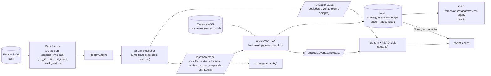

# Estratégia ao vivo: o consumidor, o stream de voltas e o evento `strategy`

O que liga a Fase 3 (o cálculo) à Fase 2 (o replay em streaming): um consumidor que, a cada volta do
líder durante um replay, calcula as probabilidades de vitória e pódio (Monte Carlo) e os alertas de
undercut, grava o resultado no Redis e o entrega por `GET /races/{ano}/{etapa}/strategy` e pelo
evento `strategy` do WebSocket.

**Leia isto antes de confiar no número.** O backtest (`docs/backtest.md`) mostrou que o Monte Carlo
**não supera "o líder atual vence"** em nenhuma fase da corrida, e é pior nos últimos 20%. Por isso
cada resultado traz as duas probabilidades lado a lado, e a página e o README dizem isso.

## O caminho dos dados



## As decisões

| Decisão | Por quê |
|---|---|
| **Stream de voltas separado** (`laps:{ano}:{etapa}`) | O stream principal é ~99% posições (110 eventos/s a 1x, ~1.760/s a 16x) e é aparado em 100 mil entradas; a estratégia precisa de ~1.400 voltas e do **histórico inteiro** da corrida (`state_until` o exige). O stream de voltas é pequeno e não é aparado no meio de uma corrida. Entra na **mesma transação** do principal: uma volta nunca está num e não no outro. O stream principal e o contrato do WebSocket **não mudam** (os campos novos ficam fora de `entry_to_json`). |
| **Payload versionado (`v`)** | O mesmo documento no hash, no stream de resultados, no WebSocket e no `GET`. Campo novo e opcional não muda a versão; mudar o significado ou remover um campo sobe. O cliente que vê uma versão que não conhece **diz isso** em vez de adivinhar (`RaceView.strategy_unsupported`; a API responde `500` claro). Um teste exige que o payload tenha **exatamente** os campos que o schema da API documenta (campo novo não pode sumir em silêncio). |
| **Instância única, com lock e standby** | O cálculo é pesado (de 0,05 s a ~1,3 s de CPU por volta) e o estado da corrida mora na memória de quem calcula. Só a instância que segura o lock `strategy:consumer:lock` calcula (o mesmo lock simples do replay: `SET NX PX`, renovado a cada TTL/3, token para nunca apagar o lock de outro). As outras ficam em standby e assumem em até o TTL (10 s) se a ativa morrer, ou na hora num desligamento limpo (`SIGTERM` libera o lock). |
| **Quem assume reconstrói o estado do stream, não do consumer group** | O estado é o conjunto de todas as voltas, e o stream de voltas guarda a corrida inteira: `XRANGE` de tudo, aplicado pelo mesmo caminho do ao vivo (dedupe incluído). O grupo `strategy` existe para o Redis lembrar até onde se leu (o lag é visível em `XINFO GROUPS`), mas a correção **não depende dele**: depois da reconstrução o grupo é posicionado no fim do que foi lido (`XGROUP SETID`) e as pendências de quem morreu são confirmadas. Se a ativa morreu entre receber a volta N e gravar o resultado, quem assume calcula a última volta (a menos que o resultado já esteja lá). |
| **A mesma `state_until` do backtest** | `compute` chama `prepare(snapshot="tempo")` e `build_context(as_of_ms=)`, as mesmas funções do backtest, com as voltas na mesma ordem em que `load_race_laps` as devolve (a ordem muda a 12ª casa significativa). Teste: o resultado ao vivo é **numericamente** o do backtest (probabilidades e alertas idênticos), também pelo Redis, com janela e thread no meio. |
| **Epoch** | Toda entrada do stream de voltas e todo resultado carregam o epoch do replay. Epoch maior = replay novo: o estado, os alertas e o cálculo em voo são descartados e o hash de resultados recomeça (no mesmo script Lua). Epoch menor = de um replay que passou, ou de um consumidor zumbi: ignorado/recusado. O `GET` esconde resultados de um replay que já passou. |
| **`GET` que só lê** | Uma requisição HTTP não pode custar ~1 s de CPU de numpy (e ninguém controla quantas chegam), e o resultado de uma volta tem de ser **um só**, o que o WebSocket anunciou. Um teste confere que, depois de várias chamadas, **nenhuma chave nova** apareceu no Redis. |
| **Evento `strategy` no WebSocket, com avisos** | O hub segue o stream de resultados junto com o da corrida (um `XREAD`, um cursor por stream); o cliente que entra no meio recebe o último resultado do armazém depois do snapshot. Os avisos de pista vão no próprio evento: **SC** (o simulador o modela), **VSC** e **bandeira vermelha** (ele não: a probabilidade ignora esses efeitos). |
| **Métrica de idade do resultado** | `f1_strategy_last_result_age_seconds`, lida no scrape. Só um resultado **gravado** a zera (um descartado na entrega, ou repetido, não é um resultado novo). Sobe enquanto não chega volta nova (replay pausado) ou a simulação trava; é `NaN` antes do primeiro. |
| **Dedupe, janela e atraso** | Dedupe por **(piloto, volta)**: a primeira entrada vence. O cálculo da volta N é agendado quando chega a primeira entrada dela e executado depois de uma **janela** (`STRATEGY_WAIT_S`, 0,3 s). Uma volta que chega **depois** do resultado do instante dela fica no estado para as voltas seguintes, mas não reabre o resultado já calculado; é contada (`late_laps`) e vai no resultado, junto de quantos carros já tinham reportado (`cars_reported`). O disparo só **avança**: uma volta velha de um retardatário nunca dispara um resultado velho. |

**O que a janela protege (e o que não).** Só as voltas que pertencem ao instante do líder (as dos
carros de trás, que cruzaram a linha *antes* dele) e chegaram atrasadas. As que acontecem *depois*
desse instante ficam fora do estado de propósito (é o que `state_until` faz). No stream do replay,
que sai em ordem de tempo, a janela não muda o resultado; ela protege o dia em que a ordem não for
garantida. O teste de embaralhamento prova a propriedade que importa: **a mesma corrida, com as
entradas embaralhadas dentro da janela, guarda os mesmos números** (em memória e pelo Redis).

## O payload (v1)

```json
{
  "v": 1, "type": "strategy", "year": 2024, "round": 10, "epoch": 3,
  "lap": 30, "total_laps": 66, "laps_left": 36, "progress": 0.4545, "as_of_ms": 2640000,
  "reliability": "indicative",
  "baseline": {"name": "o líder atual vence", "leader": "VER"},
  "forecast": {
    "n_sims": 5000, "variant": "encolhimento", "sc_probability": 0.12, "without_model": [],
    "drivers": [
      {"driver": "VER", "win": 0.62, "podium": 0.97, "win_error": 0.007, "podium_error": 0.003,
       "baseline_win": 1.0, "retire": 0.01, "expected_stops": 1.0, "source": "modelo"}
    ]
  },
  "alerts": [{"attacker": "NOR", "rival": "VER", "probability": 0.72, "margin_s": 1.34,
              "margin_sd_s": 1.2, "horizon_k": 5, "pit_loss_s": 21.0,
              "attacker_compounds": ["MEDIUM", "HARD"], "rival_compounds": ["MEDIUM", "HARD"],
              "blocked_by": null}],
  "warnings": [{"code": "virtual_safety_car", "text": "VSC em curso: o simulador não modela o VSC. ..."}],
  "inputs": {"cars_reported": 20, "cars_known": 20, "late_laps": 0, "duplicates": 0,
             "wait_s": 0.3, "constants": "sem 2024 R10 Spanish: 20 corridas (todas as outras)"},
  "computed_at_ms": 1700000000000, "duration_s": 0.8
}
```

- **`baseline_win`** é a probabilidade do comparador "o líder atual vence": 1 para quem lidera no
  instante do cálculo, 0 para os outros. Mostre-a **sempre** ao lado de `win`.
- **`reliability`**: `indicative` (até 80% da corrida: no backtest o Monte Carlo **não se
  distinguiu** do comparador) ou `experimental` (a partir de 80%: no backtest ele foi **pior**).
  **Nenhum dos dois quer dizer "confiável".** O corte é `>=` 80% para coincidir com a faixa medida.
- **`alerts`**: os alertas de undercut **ligados** (limiar 0,6, histerese em 0,5, regras duras de
  sempre). **A ressalva do viés de seleção está na documentação do campo** (`/docs`, schema
  `StrategyOut.alerts`), não no payload: o backtest só observou as paradas que aconteceram, a
  precisão medida (83% em 18 alertas, Wilson 61%–94%) é **otimista** e a revocação não é mensurável.
- **`inputs`**: `cars_reported` (carros no estado do cálculo) contra `cars_known` (pilotos vistos no
  stream) diz se o resultado saiu com o pelotão incompleto.

## Como foi testado

| O quê | Como |
|---|---|
| Equivalência com o backtest | `tests/strategy/test_live.py`: probabilidades, pódios e alertas **idênticos** aos de `prepare`/`simulate`/`assess_all` sobre as mesmas voltas; e pelo Redis (`test_strategy_consumer.py`). |
| Embaralhamento | 6 sementes de permutação de tudo o que cabe numa janela (em memória) e um embaralhamento por volta pelo Redis: mesmos números. |
| Duplicata | Cada entrada duas vezes, e uma volta inteira republicada: resultado e eventos publicados idênticos; as repetições contadas. |
| Volta atrasada | Depois da janela: no estado, contada, sem reabrir o cálculo; vale na volta seguinte. Empate no mesmo milissegundo e atraso medido contra o resultado **mais novo**. |
| Futuro fora do estado | Entradas de depois do instante do líder presentes quando a janela fecha: mesmo resultado. |
| Queda | Simulada (a ativa sai sem liberar o lock nem confirmar entregas; a standby assume pelo TTL, reconstrói, calcula a última volta, e o grupo fica posicionado e sem pendências) **e real**: `SIGKILL` num processo `python -m strategy.service` de verdade. |
| Lock | Duas instâncias, uma ativa; desligamento limpo passa o lock na hora; lock roubado: a instância para de entregar e um resultado em voo é descartado. |
| Epoch | Replay novo: resultados e alertas recomeçam, o resultado do epoch antigo é recusado; o `GET` e o WebSocket não mostram o que é de um replay que passou. |
| Cadeia inteira | `tests/integration/test_strategy_e2e.py`: banco → motor de replay → stream de voltas → consumidor → armazém → hub → WebSocket e `GET`, tudo de verdade, com o relógio do replay falso. |
| Mutação | 31 mutações em `live.py`/`payload.py`, 16 no consumidor, 8 no hub/API/armazém: todas derrubam um teste (as sobreviventes viraram testes). |

## O que NÃO foi validado

- **Compose.** O serviço `strategy` (duas réplicas, uma ativa) está no `docker-compose.yml`, mas **não
  rodei `docker compose up`**: não há Docker CLI no ambiente de desenvolvimento. O que rodou foi o
  processo real (`python -m strategy.service`, o `SIGKILL` do teste) contra o Redis e o Timescale
  reais. A sintaxe do YAML e a mescla das âncoras foram conferidas por parse.
- **Só 5 das 24 corridas têm replay** (R6, R10, R13, R16, R21): as outras foram ingeridas com
  `--laps-only`, sem o horário absoluto das voltas (`completed_at`) que o motor usa. A R21 (Brasil) é
  chuva, fora do domínio do modelo.
- **Os alertas ao vivo são avaliados no instante em que o líder completa a volta; o backtest os mediu
  no instante do atacante.** Para quem está atrás, o estado do alerta é uma volta mais velho do que o
  medido. Foi o preço de um contexto só por volta (`build_context` custa ~0,15 s; um por atacante
  seriam ~3 s por volta). **Esta forma de alertar não foi avaliada**: a precisão de 83% do backtest
  não vale para ela.
- **O backtest mediu as voltas 5, 10, 15…; ao vivo calcula-se toda volta a partir da 5.** É a mesma
  função, mas as outras voltas **não foram medidas**.
- **As constantes saem das outras 20 corridas**, sem a reproduzida (a configuração medida), não só das
  anteriores no calendário: numa corrida nova de verdade o sistema saberia menos.
- **A histerese do alerta não sobrevive a uma troca de instância**: um par "ligado" a 0,55 recomeça
  "desligado" na que assume.
- **Um processo congelado por mais que o TTL** (pausa de GC, VM suspensa) pode entregar um resultado
  depois de perder o lock. O armazém limita o estrago (recusa epoch antigo; a mesma volta nunca é
  publicada duas vezes), e como o cálculo é determinístico o segundo a chegar teria os mesmos números.
- **Uma volta é pulada** se a seguinte chega antes de a simulação terminar (a política "descarte a
  antiga, sem fila"): o `GET ?lap=N` de uma volta pulada é `404` com a última calculada.
- **Consumidores antigos ficam cadastrados no grupo** (`XGROUP DELCONSUMER` não é chamado): inofensivo,
  mas cresce a lista em `XINFO CONSUMERS`.
- **Python 3.12** (o alvo do CI e do Dockerfile) nunca rodou: o ambiente local é 3.13.
- Como em tudo o que é do Monte Carlo: **não há prova de que a probabilidade ajude**; o backtest diz
  o contrário. O que esta etapa entrega é o encanamento, medido, e a ressalva sempre à vista.

## Como rodar

```bash
docker compose up -d --build               # sobe db, redis, migrate, app, worker e 2x strategy
curl -s -X POST localhost:8000/replay/2024/10/start -H 'content-type: application/json' -d '{"speed": 16}'
curl -s "localhost:8000/races/2024/10/strategy" | python -m json.tool
python scripts/watch_race.py --year 2024 --round 10      # mostra o Monte Carlo ao lado do líder atual
# a página: http://localhost:8000/frontend/ (etapa 10), painel "Estratégia"
```

Sem Docker para o consumidor: `python -m strategy.service` (precisa do Redis e do Postgres; variáveis
`STRATEGY_METRICS_PORT` (9109, `0` desliga), `STRATEGY_WAIT_S` (0,3), `STRATEGY_LOCK_TTL_MS`
(10000) e `STRATEGY_N_SIMS` (5000)). Suba duas cópias para ver o standby.

## Métricas do consumidor (`:9109/metrics`)

| Métrica | Tipo | O que mede |
|---|---|---|
| `f1_strategy_consumer_active` | gauge | `1` na instância que segura o lock, `0` em standby (a soma entre instâncias deve ser 1) |
| `f1_strategy_last_result_age_seconds` | gauge | Idade do último resultado **gravado** (NaN antes do primeiro) |
| `f1_strategy_simulation_duration_seconds{result}` | histograma | Duração da simulação (`completed`, `cancelled`, `stale`, `failed`) |
| `f1_strategy_simulations_total{result}` | counter | Simulações por resultado |
| `f1_strategy_laps_total{outcome}` | counter | Entradas de voltas: `applied`, `duplicate`, `late`, `stale_epoch`, `status`, `ignored`, `malformed` |
| `f1_strategy_results_total{outcome}` | counter | Entregas: `written`, `exists`, `fenced`, `skipped`, `dropped` |

Os únicos rótulos são `result` e `outcome`, com valores fixos: nunca piloto, corrida, volta ou ID
(há um teste que varre o registro).
